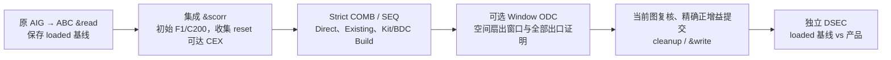

# &stran2 技术路线、贡献与实验复评

**Period:** Sep. 13-26, 2026<br>
**Measurement refresh:** Oct. 1, 2026

**Timing correction.** Earlier draft timings were parsed from mixed ABC command output that also contained `&r` and auxiliary commands. Those commands could reset or change the observed timing boundary, making some numbers look artificially low. All speed results below now use exact boundaries: an explicit transform timer for Strict and monotonic direct-child wall time for Window ODC. Every baseline/candidate/`&scorr` comparison is paired on the same host with the same boundary; DSEC time is excluded.

**扩展AIGER分区更正（2026-10-01）。** 历史HWMCC330的330例原始AIGER全以`B=1`表示性质。143例无约束输入在raw→ABC-loaded时已经由`O=0/B=1`写成`O=1/B=0`；其余187例`C>0`的loaded图仍保留`B/C`，但旧Gia复制会丢失`nConstrs`，产品把性质/约束分区写为普通输出。旧裸DSEC逐信号比较，不核对`O/B/C`类型，故PASS**不证明原始HWMCC typed接口等价**。全330例只读重算的主批次为：scorr产品301、旧DSEC PASS262，其中分区错且PASS146；Strict speed产品270、旧PASS248，其中分区错且PASS137；ODC产品192、旧PASS190，其中分区错且PASS108。原始raw分区真正保留且旧DSEC PASS的产品三臂均为**0**。若只保留相对ABC-loaded信号网络既分区不变又旧DSEC PASS的子集，三臂分别为116/111/82例；Strict有Build数值的104例历史结构Build/SEQ等例为0.744968%/0.960054%，ODC的75例为2.577205%/2.728030%，这些仍非本轮exact非组合Build主指标，也不是raw typed正确性。此前HWMCC26的9臂消融按同样规则，全臂共同旧PASS21例缩至加载信号子集14例，后者原SEQ、强COM后残余及组合提前取得分别为1.169072%、0.466533%、0.629604%；旧21例百分比不可当原性质口径。New58/Train100的已完成产品未发现此分区错配，New58原Strict speed的56例Build/SEQ 2.774952%/3.068607%保持。下文旧HWMCC百分比只作为**已保存加载信号图的历史结构观察**，原始typed性质的正式比较必须先恢复分区并做独立typed校验；不能继续引用旧PASS覆盖作为raw性质正确性保证。逐行和复算证据在 `/mnt/home/zhaoxiran/script2/evidence/stran2_seq_guide_20261001/aiger_typed_audit/`。本轮Guide固定55例是普通AIGER，不受该分区问题影响。

**指标更正（2026-09-30 最终审计）。**历史表的 Build 列为 `seq_commit_build_and_gain / loaded AND`：在 Strict 中该字段是已选候选的结构 marginal gain 求和，未分配组合提交产生的额外 cleanup；在 ODC 中则按同一提交集合做精确类型归因。因此历史 Strict 的 “Ordered Build” 名称不准确。下述最新审计另给出按 Direct→Build 顺序重放的精确 Build、自由状态 SAT 反例确认的非组合 Build 和完整流程净差。阶段/最终总缩减均使用实际图 AND 差。百分比默认是逐例相对原 loaded AND 再等例平均；百分点记为 pp。


## 当前主目标（用户于 2026-10-01 明确）

论文贡献的主指标是：**组合不等价、但从指定 reset 出发时序等价的新构造 Build 所带来的精确 AND 缩减**。用户关心的是这种 Build reduction；整条 `&stran` 的总缩减、Direct 收益、组合等价的 Build 收益及完整证明/CBS-only 的整流程差，不替代这个主指标。

每个计入主指标的 Build 必须同时满足：①构造了替换表达式；②同一提交前图上的自由 PI/RO 根差异 miter 为 SAT，且反例复核成功，UNKNOWN 不计入；③根关系通过完整时序证明；④实际安全提交产生正的精确 cleanup 收益。对同一选中集合移除这类 Build、保留其他候选，再重放计算其增益；逐例除以原 loaded AND 后报告等例均值，同时给出 AND 总数、加权比例、覆盖案例和独立 DSEC。

还须在明确参数下让普通 `&scorr` 与匹配组合搜索达到联合稳定后评估。`&scorr` 本身也有时序证明能力；新方法的待验证贡献是发现并实现它未取得的新表达式缩减，不能仅凭“使用归纳”判定独有性。此前的起点是 Fast35 联合基线后的 **0.28169% / 35 AND / 29 个 Build / 8 个受益案例**；该具体替换的非组合性已证实，尚不构成任意组合优化算法最优面积的下界。2026-10-01进一步在同一Fast35提高至80 AND，但较大独立集的质量/覆盖仍弱；详见下一节。用户于 2026-10-01 在后继会话明确继续并行 Guide 研究；执行约定见下节。

## 2026-10-01 云端接续：可复用非线性输入基与实际门成本

本节接续用户对上述暂停任务的**重新启动授权**：优先理论分析和代码实现，在便携环境完成可负担的正确性验证，再由用户运行较大实验。基线为 `112d8e9f3781ceb6aba65e9953dceb6e49e0acab`；55 个 `first_seq` 输入 SHA256 已全部核对。以下独立 Python 原型不是生产 `&stran2` 集成，也没有复原包外原始日志。本节不改变旧实验的失败、超时和归因结论。

### 理论与实现边界

此前 cut-leaf 的下界约束提示应改变输入基，但**原生算法本来就支持非线性 divisor 和一/两门 recipe**，不能把这两点作为新贡献。新研究入口 `research/stran2-guide-20261002/nonlinear_divisors/` 用固定的 TFI、局部 peer、reset/image 签名 alias 池，枚举一/两门表达式，按规范化及保留依赖后的保守新增 AND 代价筛选，再逐候选独立证明；精确实现成本只由最终选择集合重建确定。需要检验的变化是输入池及其截断、pair frontier、证明获得方式；相对 native 的逐配方新颖性仍为 `NOT_CHECKED`。

令原转移为 `T(s,u)`，旧根与新表达式差为 `D(s,x)`。原型要求分别证明：

- `D(0,x)=0`，对任意当前 PI `x`；
- `D(T(s,u),x)=0`，对任意前态 `s`、前一拍 PI `u` 与独立的当前 PI `x`。

二者成立即覆盖 reset 时刻及所有后续可达状态，因为任意后续状态都是原转移的一步像。此处没有借用其他候选作假设，也不是“有限 BMC 未发现反例”。它是**充分而不完备的完整时序关系证明**：例如 reset 为 0 且 `q'=q` 时，`q=0` 在可达域成立，却无法由 unrestricted image 证明。SAT/UNKNOWN 不得计为成功，也不能将任意前态的 SAT 模型误作为真实可达 teacher。

所有计入的候选须另有自由 PI/RO SAT 及完整赋值独立回放。recipe 只引用编号小于 root 的原节点，保持组合无环；重建按原拓扑顺序进行，支持值等价可逐节点归纳，因而保持 PO/RI 及后续状态轨迹。选择器保守排除删除区域重叠与 divisor 依赖冲突。最终收益来自同一选择集合的 `replay_without_build.aig` 与 `product.aig` 的精确结构哈希/cleanup 差，另存原输入到空选择重放的 cleanup 差，避免把无关 cleanup 记为 Build。

表达式哈希成旧节点、常量或仅产生死的新门时必须降为 Direct，不能按语法 gate 数计 Build。独立审查实际捕获并修复了“死中间门使常量替换被误记 Build”的问题，并补充反例测试。产物要求输出确为新构造节点且新门在最终图中存活；原输入到空选择、原输入到产物分别运行独立 DSEC。解析器拒绝不支持的非零/未知 reset 及扩展 typed AIGER 接口。

### 两项工程修正

1. 旧便携入口 `run_cut_image.py` 间接导入 `guide.py` 时立即读取原服务器 `/mnt/.../joint_baseline/manifest.json`，在新主机真实失败。现在仅在调用旧服务器 runner 时延迟加载该配置，不伪造命令或环境。四项便携回归通过；旧 cut 合成自测 96 个查询通过，b03 full-cut 的 4 配方、2 根、2 AND 重叠潜力及查询计数与打包历史一致。
2. `cecTranBuild.h` 新增显式 raw-budget 入口，默认入口仍使用原 `min(N,MFFC−1)`。仅 cost-aware TraceBuild 请求已有用户 N 上限，之后仍必须通过 frozen-hash、真实 MFFC 保留、完整证明及正 cleanup。原来这个 lane 的实际成本判断在枚举之后，无法发现语法门数超过旧上界、但哈希后只有少量新门的配方。新增真实 iterator 自测以 `(a&c)&b` 与池外已有共享 `a&b` 为例，证实默认 1 门枚举不可得、显式 2 门预算可发现实际只新增 1 门且净减 1 门的表达式。没有修改 root 的真实 MFFC。完整 `&stran_resub_test` 通过。此修正针对实验 TraceBuild 的生成边界；其 output-boundary/mode27 语义**不能冒充本课题 Strict root Build 的新面积贡献**。

### 固定六例短批次与一次机制迭代

预先固定不同设计来源的 b03、i2c、des_area、b20_opt、mem_ctrl、wb_dma 六例，不按结果替换案例。参数统一为 pool 24 / reservoir_cap 参数 128（分别作用于 TFI/peer/alias 收集，不是合并池总数上界）/ TFI depth 6 / peer hops 1 / aliases 8 / 1–2 raw AND / 每根最多 8 配方 / 256 lanes / seed 2026100201；每例搜索、证明和重建总预算 120 秒，两个独立 DSEC 各 120 秒、另计成本。solver 的每查询 1000-conflict 边界未改。使用 2 workers，不作正式单机性能宣称。

首版 v2 的三个完整例为 b03 5 AND、i2c 10 AND、des_area 0；其余三例超时。剖析发现候选命中时重复计算 MFFC/依赖保留，随后改为每根 protected-mask 缓存和精确 top-k，保留下来的配方再做独立引用计数核验。缓存单独消融在三个完整例保持配方、成本、free witness、证明状态一致，CNF、query 和两份重放 AIG 均逐字节相同。再修复两门原始表达式在 MFFC=2 时被过早排除的捷径，让实际 fresh-gate 代价决定收益。i2c 因此有 32 条新保留配方、挤掉 28 条旧配方，但新配方均未通过 step 证明；最终已证集合与产品没有改善，不把该语法修正宣称为涨分。

冻结 v3 的结果：

| 案例 | 搜索/证明状态 | 已证关系数 | 实际选中 Build | 首 SEQ 输入→产物 AND | 精确非组合 Build AND |
|---|---|---:|---:|---:|---:|
| b03 | 完成，双 DSEC PASS | 43 | 5 | 84→79 | 5 |
| i2c | 完成，双 DSEC PASS | 40 | 6 | 1118→1108 | 10 |
| des_area | 完成，双 DSEC PASS | 0 | 0 | 4752→4752 | 0 |
| b20_opt | 120s TIMEOUT | 完整运行缺失 | — | — | 缺失 |
| mem_ctrl | 120s TIMEOUT | 完整运行缺失 | — | — | 缺失 |
| wb_dma | 120s TIMEOUT | 完整运行缺失 | — | — | 缺失 |

三例有效集合的 15 AND 是该独立原型在冻结前缀上的真实缩减，**不是**相对所有既有 native/Guide 运行的新增贡献。等例百分比以各自原 loaded AND 为分母；结果聚合文件给出 1.417864%，但其被 b03 的小分母主导，且六例仅三例完成，不能据此声称大电路普遍改善或推广到全55。

des_area 并非没有候选：936 条正成本、自由态 SAT 配方中，599 条 reset 与 step 均失败，337 条 reset 通过而 step 失败。由此把下一次诊断指向候选泛化和 image 证明限制，而不是无依据继续扩大 cut 完成器。b20_opt 在超时前有完整证明三元组，但尚未获得正式完整批次产物；任何后续部分证书审计必须另开输出目录、记录额外成本，不能改写原 TIMEOUT。

证据索引：`research/stran2-guide-20261002/cloud_validation_20261001/` 保存输入哈希、自测、缓存差分及 v2/v3 计划和聚合结果；随补丁交付的实验归档保留原始查询、候选、产物、DSEC 日志及冻结源文件。最终源文件与测试入口位于 `nonlinear_divisors/`。

### 额外成本的部分证书审计与两步像诊断

b20_opt 的 v3 原运行维持 **120s TIMEOUT**。另启 `audit_partial.py`，对已经刷盘的连续 4,142 行查询结果只采用完整三元组；末候选只有两行，明确排除。重建全部 5,886 个原候选的 CNF/query 与原文件逐字节相同，全部自由赋值与成本重新回放，再对 74 个原已完成的正证书执行 222 次新查询，全部为 SAT/UNSAT/UNSAT。选择 24 个无冲突 Build，实际从 **11,270 降为 11,233 AND，精确减 37 AND**；空选择及产物 DSEC 均 PASS。额外审计总 wall 15.76s，其中约 13.81s 非 DSEC；这不是同 120s 预算下的完整成功，不能修改原六例覆盖率或合并进正式完整批次均值。独立复审另以单独 AIGER 解码器回放 74 份自由 witness、128 组任意 PI/RO 的全部 PO/RI，按保存的 24 配方重建得到逐字节相同产物，并重跑 DSEC PASS。

这是此前 cut-only 方向零候选的较大设计上的真实独立原型产品信号，值得交给用户扩大验证；它仍不是相对全部 native 流程的新颖性或跨大设计普遍收益证据。`audit_partial.py` 不扩大候选发现，只审计完整、来源绑定的已有查询前缀，原 TIMEOUT 文件保持不可变。

另以同一冻结候选做 `deeper_image.py` 诊断：必须同时证明 reset 第 0、1 帧，以及任意前态经两次转移后的像；各拍 PI 独立，不省略中间 reset 帧，也不把 image SAT 当可达反例。三个完整案例共额外 11,457 查询、16.953s，没有 UNKNOWN 或超时。des_area 原 337 个 reset 通过/step 失败的候选全部在真实 reset 第1帧 SAT，故它们是错误候选而非单纯证明器不够深；这里未导出并回放 SAT 轨迹，不称为已验证 teacher 反例库，不能靠增加 image 深度救回。i2c 的 2,880 个 step-SAT 配方中，532 个 reset0 SAT、另352个 reset1 SAT，其余1,996个两步像 SAT（后者不代表已证可达），无新增证明。b03 有3个新增完整关系证明，原一步 step-SAT 状态保留。显式 depth2 证书产品审计另外重新核9个查询后，旧43关系参考产品减5 AND、新3关系单独产品减3 AND、合并集合选8个 Build 实际减8 AND（84→76）；从同一合并选中集合移除 depth2 候选后减5 AND，因此深度2的精确边际为3 AND。四种重放的8次 baseline/product DSEC 均 PASS。独立复核确认联合集合减去 depth2 后的选择身份未变，8份 free witness、512组任意 PI/RO 的全部 CO 与四份产物重建均通过，再独立重跑联合产物 DSEC PASS。这些仍是额外诊断/审计成本下的独立原型结果，不改写原120秒六例矩阵。

### 用户侧复现入口

在上述冻结分支应用补丁后：

```sh
bash research/stran2-guide-20261002/build_query_solver.sh /tmp/stran2-query-solver
make ABC_USE_NO_READLINE=1 -j8 abc
./abc -c '&stran_resub_test'
python3 -B research/stran2-guide-20261002/test_portable_imports.py
STRAN2_SOLVER=/tmp/stran2-query-solver STRAN2_ABC="$PWD/abc" \
  python3 -B -m unittest discover \
  -s research/stran2-guide-20261002/nonlinear_divisors -p 'test*.py' -v
python3 research/stran2-guide-20261002/nonlinear_divisors/run_batch.py \
  --pilot --solver /tmp/stran2-query-solver --abc "$PWD/abc" \
  --workers 2 --out /tmp/stran2-nonlinear-pilot-user
```

补充深度测试单独在新 Python 进程运行，避免混合当前与冻结模块；未设置 `STRAN2_FROZEN_PACKAGE` 时这些测试会明确跳过，不能报为通过：

```sh
STRAN2_FROZEN_PACKAGE=/tmp/stran2-nonlinear-pilot-user/source \
STRAN2_SOLVER=/tmp/stran2-query-solver \
  python3 -B research/stran2-guide-20261002/nonlinear_divisors/test_deeper_image.py
python3 research/stran2-guide-20261002/nonlinear_divisors/deeper_image.py \
  --run /tmp/stran2-nonlinear-pilot-user --case 005_b03 \
  --solver /tmp/stran2-query-solver --out /tmp/stran2-b03-depth2-user
python3 research/stran2-guide-20261002/nonlinear_divisors/audit_depth2_product.py \
  --source-case /tmp/stran2-nonlinear-pilot-user/005_b03 \
  --proof-dir /tmp/stran2-b03-depth2-user \
  --solver /tmp/stran2-query-solver --abc "$PWD/abc" \
  --out /tmp/stran2-b03-depth2-product-user
```

若 b20_opt 原运行确为 TIMEOUT 且存在完整证明前缀，可另做额外成本审计：

```sh
python3 research/stran2-guide-20261002/nonlinear_divisors/audit_partial.py \
  --attempt /tmp/stran2-nonlinear-pilot-user/034_b20_opt \
  --solver /tmp/stran2-query-solver --abc "$PWD/abc" \
  --out /tmp/stran2-b20-partial-user
```

新输出目录必须尚不存在。先复现六例及缺失状态，再决定是否用 `--all` 替换 `--pilot`；不要把超时作零分，也不要把仅有关系证明、未有实际重放与 DSEC 的候选计入主指标。全55对照、与原生配方逐项比较及生产集成尚未完成。


### 第二轮：预算内保存完整证明与产物的 anytime 流程

新增显式 opt-in `nonlinear_divisors/anytime.py`，原 standalone 入口及其 v3 证据不变。固定每32个 eligible root 为一块，在同一不可变原图上搜索、先检查 reset，再检查自由态/一步像；只对同一冻结 CNF 和完全相同的 assumptions 复用 SAT/UNSAT，不缓存 UNKNOWN 为成功。每份查询原始收据、候选、选择集合和产品写入独立不可变 generation，全部写完后才发布 checkpoint。supervisor 只接纳在本例120秒 transform deadline之前实际收到的完整 checkpoint，终止整个 owned worker/solver 进程组；不得在 deadline后补证明或重建。若后来选择效果下降，保留之前更好的完整产物。截断搜索返回 `BUDGET_EXHAUSTED`，绝不伪装为完整穷尽。

28项新增回归覆盖中断写入、伪造/缺失证书文件、deadline实际收件时间、完整子进程组清理、UNKNOWN排除、旧checkpoint保留、CNF cache 身份、solver替换及保留mtime的修改检测，全部通过；原30项基础回归仍通过。独立复核重放了所有69份自由态 witness、768组任意 PI/RO 的全部 CO，并逐字节重建六份产物，原始证明收据及DSEC日志身份一致。

首版 anytime v1 暴露一个通用热路径开销：每个证明阶段前后重复 hash 152MB 的 solver 可执行文件。v2 在 case/控制器边界保留完整 SHA256，阶段内使用固定的 device/inode/size/mtime_ns/ctime_ns 身份并在调用前后检查；不更新中途基准、不改 solver 字节，检测漂移即失败。129个共同 proof chunk 的候选语义、CNF和query一致，26份共同产品逐字节相同。这是完整性检查的机械优化，不是放宽证书条件。

同一预固定六例、相同 pool/搜索规则、chunk32、2 workers及120秒transform预算：

| 案例 | anytime v1 精确 Build AND | anytime v2 精确 Build AND | v2 搜索状态 |
|---|---:|---:|---|
| b03 | 5 | 5 | COMPLETE |
| i2c | 10 | 10 | COMPLETE |
| des_area | 0 | 0 | COMPLETE |
| b20_opt | 37 | 74 | BUDGET_EXHAUSTED |
| mem_ctrl | 0 | 0 | BUDGET_EXHAUSTED |
| wb_dma | 2 | 2 | BUDGET_EXHAUSTED |

两版各六个 incumbent 均通过原图到空选择及原图到产物的双DSEC；**仍只有3/6完成全部搜索**。mem_ctrl 的0只是预算内保留的空选择基线，不能推断全设计没有机会。这里 b03 的5是一步像主流程，不包括前述额外两步证明得到的3 AND。

b20_opt 的 v1 37-AND产物在67.903s收到，与原额外成本审计的24个配方及产物逐字节相同；v2 的57个 Build 产物在119.013s收到，实际 **11270→11196，减74 AND**，其 checkpoint 已完成136个proof chunk/4352个eligible root，仍未穷尽全设计。120秒只覆盖 worker启动、签名、搜索、形式证明及完整checkpoint构建；控制器之后的只读收据/hash审计另计0.21–0.52s/例，两个独立DSEC亦另计。b20_opt 本次总wall约122.20s，不能把端到端时间写成120s。未改变此前 v3 的 TIMEOUT，也未证明相对原生算法的新颖性。

剩余瓶颈有明确漏斗：mem_ctrl 仅搜索267/4418个eligible root，1474个完成形式检查的候选均reset通过而image失败；完成块的搜索/证明成本约108.40/9.86s。wb_dma 搜索872/1671根，4910个候选仅4个关系证明，搜索/证明约102.71/13.57s。b20_opt 搜索4384/4895根，5212个候选中134个关系证明，搜索/证明/checkpoint成本约62.81/51.09/4.31s。计数应区分已搜索、已完成证明块及选中最佳checkpoint，不能混用。下一步应解释无效候选的样本泛化和构造开销，而不是盲目增加证明深度或案例预算。

**Direct 替代敏感性检查。**为了避免把可由零门替代取得的收益解释为必须构造新表达式，对69个已选根，仅检查常量和原记录pool/已用divisor的正反相，共3352个literal；签名匹配只是必要筛选，剩余11个候选均重新做自由态/reset/image查询。10条Direct关系获证，覆盖b03的2个根及i2c的4个根，全部自由态SAT；每根在保持其它选择不变的精确重放中都比原Build多省1 AND。b20_opt的57根及wb_dma的1根，在这个有限pool内没有获证Direct替代，不能外推为全图不存在替代。

对这两个小例另做完整敏感性产物：b03两条Direct单独减4 AND，保持另3个原Build后混合减7 AND，故在这些Direct之后剩余Build精确贡献3 AND；i2c四条Direct单独减11 AND，保持另2个Build后混合减14 AND，剩余Build贡献3 AND。五个保留Build的输出仍确为新建且存活；8次独立DSEC全部PASS，额外重放/验证wall约3.26s。原anytime的5/10及总91 AND是实际原选中产品的定义指标，未被改写；但不能把它们全解释为没有Direct替代的构造贡献。这个局部对照也不是全图Direct饱和基线，不能简单将91扣减成新的正式全体指标。两步像额外b03关系不在这次一阶段Direct检查范围内。

复现（在v1补丁之上应用v2增量补丁）：

```sh
STRAN2_SOLVER=/tmp/stran2-query-solver STRAN2_ABC="$PWD/abc" \
  python3 -B -m unittest discover \
  -s research/stran2-guide-20261002/nonlinear_divisors -p 'test_anytime*.py' -v
python3 research/stran2-guide-20261002/nonlinear_divisors/anytime.py \
  --pilot --solver /tmp/stran2-query-solver --abc "$PWD/abc" \
  --workers 2 --chunk-roots 32 --wall-seconds 120 \
  --out /tmp/stran2-anytime-user
```

证据摘要、独立复核及共同前缀差分保存在 `research/stran2-guide-20261002/anytime_validation_20261001/`；原始chunk证书、generation产品、失败/预算状态、冻结源文件随v2实验归档交付。不得把“6份已验证incumbent”写成“6份已完整搜索的结果”。

### 第三轮：固定 image 域的反例引导构造诊断

`image_cegar_diagnostic/diagnostic.py` 首先只作机制诊断，不修改生产算法。固定原六例中的 mem_ctrl、wb_dma、b20_opt、des_area 的首个 32-root chunk，保持原图、divisor 池、排序、语法、代价和证明类不变；b20 首块没有候选，原样保留。对 reset-UNSAT/free-SAT/image-SAT 候选，独立 helper 在相同 1000-conflict 限额下返回前态、前拍 PI、当前 PI，并在原始 AIG 上回放转移与根差异；随后按 `(当前PI, 后继状态)` 精确去重。这些样本只约束固定的 reset∪unrestricted-image 候选类，**不是可达轨迹**，不能灌入一般 reachable-state teacher 或 depth2 lane。证明仍须重新完成原三元组；样本一致本身不是证书。

mem_ctrl 的 232 个 SAT 模型归并为 14 个 image 样本，正代价签名命中从 819,778 降到 48,516，同池重新搜索发现 179 个新保留配方，其中 49 个完整证明通过；相同数量随机 image 样本的对照没有发现新保留配方。wb_dma 的 173 个模型归并为 28 个样本，发现 65 个新配方、9 个新证明；4 个旧证明仍满足全部新样本，随机对照亦无新配方。des_area 新增 6 个配方但无新证明；b20 首块仍为空。这是额外诊断成本的机制证据，不能把 mem 搜索从 23.59s 降到 1.53s 当成端到端加速：模型生成、控制臂、重证明及审计都需要成本。

另行 `audit_products.py` 对 49 个 mem 新关系、9 个 wb 新关系和 4 个 wb 旧关系执行 62 个新证明三元组及精确产品重放。mem 的 Build-only 产品选 6 个 Build，9432→9410，减 22 AND；wb 的产品选 6 个新 Build，3703→3680，减 23 AND。但 mem 选中根的 300 个常量/池内/实际使用 divisor 的 Direct 对照得到 10 个正收益关系，涉及 5 根：Direct-only 减 25，混合产品减 27，混合集合只保留 root1263 的一个 fresh Build，**同一混合集合的真正条件 Build 边际仅为 2 AND**。wb 同范围 300 个 Direct 对照无正收益证明，6 个 Build 的边际为 23 AND；旧池单独产品减 2，故旧独立产品到新混合产品的差为 21，而移除同一新混合选中集合的新 Build 为 23，两种差不可混淆。此范围不是全图 Direct 穷尽。

最终产品审计 `/tmp/image-cegar-products-v3/` 的 20 个 baseline/product DSEC 全 PASS，独立复审另有 4 个 DSEC PASS；所有 22 个保存的 AIG 在审计 v1/v2/v3 逐字节相同。独立检查还回放 614 份 witness、1986 个证明查询和每产品 128 组任意 PI/RO 的全部输出。额外审计成本 mem 为 29.94s（非 DSEC 4.09s），wb 为 4.83s（非 DSEC 1.52s）。诊断、额外产品和后续等预算在线运行是三个独立实验，不能混算成本或改写旧 TIMEOUT。

补查同一一/两门语法中经结构哈希变成零新增门、但指向池外原节点的 Direct：`hash_direct_audit.py` 在 61 个确定性小图、147,552 个暴力规范化配方上与优化收集器完全一致。anytime-v2 b20 的 57 个选中根额外暴露 234 个 literal，CEGAR wb 的 6 根额外暴露 14 个，全部被保存的 image 样本反驳，独立原始 AIG 模拟器复核 248 个反例通过；没有值得调用 SAT 的额外候选。两例分别额外耗时 1.43s/0.47s。这个阴性结果只补全上述冻结池的一/两门哈希 Direct 范围，不表示全图不存在其他 Direct。

### 在线 image 引导 v1：等变换预算与额外 Direct 归因

显式 `--image-model-solver` 开启 `image_guided.py`；默认 mode-off 保持原 anytime 行为，b03 的 20 份关键语义、查询及产品与冻结 v2 对照一致。初始 pool/rank/alias 完全冻结，反例只更新构造签名；完成证明块并保存 checkpoint 后，才从完整 reset-UNSAT/free-SAT/image-SAT 证书提取独立模型、原图回放、精确赋值去重与完整 root+pool 投影新颖性检查。所有查询、反馈、重搜、重建仍在同一个硬 120s 预算内；普通 proof solver 和证明原图不变。已尝试候选按语义身份排除（含 UNKNOWN），但排除发生在原 bounded top-k 后，因此终止仅表示“没有新的已返回 top-k”，不是枚举所有更低排名的配方。已证候选不因 teacher 版本变化丢弃。

冻结 `/tmp/image-guided-pilot-v1/` 对原六例、相同每查询 1000 conflicts、2 workers 的结果如下。Direct 审计严格另计成本，不称整套混合产品在 120s 内生成。

| 案例 | 在线搜索状态 | Build-only AND | 原 anytime-v2 Build-only AND | 额外审计后同一混合集合 fresh Build 边际 |
|---|---|---:|---:|---:|
| b03 | COMPLETE | 5 | 5 | 3 |
| i2c | COMPLETE | 13 | 10 | 7 |
| des_area | COMPLETE | 0 | 0 | 0 |
| b20_opt | BUDGET_EXHAUSTED | 66 | 74 | 65 |
| mem_ctrl | BUDGET_EXHAUSTED | 136 | 0 | 41 |
| wb_dma | COMPLETE | 83 | 2 | 76 |

六个保留产品的 12 次 baseline/product DSEC 全 PASS；121 个选中 free witness 独立回放、六图逐字节重建及每图 128 组自由赋值全部 CO 对照通过。完整反馈审计覆盖 275 个完成轮次、8792 个 image 模型、1809 个重建新约束及 10908 个完成候选身份；与旧 v2 都扫描到的 6468 根具有完全相同的池及池来源记录。b20/mem 的选中 checkpoint 分别在 104.574s/85.294s 被 supervisor 收到；两者搜索仍未完成，不能用有效 incumbent 掩盖覆盖不足。

`image_cegar_diagnostic/audit_online_products.py` 对全部 121 个选中根，审计常量、saved pool、实际使用 divisor 的两种相位，以及同一一/两门语法哈希成零 fresh-gate 的池外输出；共 6374 个 Direct 候选。每个证明绑定不可变 CNF、精确 assumptions、solver 与原始 receipt；重放 Direct-only、混合选择、从**同一混合选择**移除 Build 三种产品，并验证实际新门仍在最终图存活。最终 `/tmp/image-guided-attribution-v3/` 与初版所有 36 份 AIG 和 Direct 候选语义逐项相同；18 个产品臂均有 PASS 证书，允许只在原输入、输出图、ABC、日志身份完全一致时复用 DSEC，不能把复用写成新运行次数。

**全原图结构 alias 补查已完成。** materialized-helper 对照发现旧版 wb 的一个 recipe 等于编号晚于 root 的原节点；其 fanin 都早于 root，不能仅凭编号较晚认定复用会成环。随后对两臂全部选中配方及实际混合集合进行了完整原图 canonical hash、独立原始 AIG 解码、依赖无环和精确同集合重放：新版121个输出全部结构新，旧版69个仅 wb/root759 是已有表达式。故新版192 AND保持，旧版有界 Direct 后的82应更正为80 AND。这个补查排除了原图**结构相同**的表达式，不证明不存在其他布尔等价旧节点或更广的顺序 Direct。详见下文全图更正。

在上述较窄范围内，条件 Build 合计 **192 AND**，相对原 loaded AND 的等例均值 **0.664383%**、加权比例 **0.273528%**；按绝对 AND 的最大贡献移除 wb_dma 后剩 116 AND、等例 0.638180%；主指标等例均值的最大贡献却是小分母 b03，移除它后剩 189 AND、等例 **0.328509%**，小例分母效应必须保留。它仍是冻结前缀上、选中根的有界 Direct 集下的独立原型结果，不是全图 Direct 饱和或 native 新颖性验证。mem 的 Direct-only 重选减 123、混合减 156、同混合集合只保留 Direct 减 115，故 Build 边际是 **156−115=41**，不能误用不同选择的 156−123。mem 还发现两个原池外的哈希 Direct，但其保留内部门使实际代价不占优：root1286 的 Direct 减4、Build 减7，root1375 的该 Direct 减1、另一 Direct 减8。证明有 Direct 替代不等于证明它支配 Build。

初次完整 Direct 归因新增 wall，按表中顺序为 0.63/1.15/0.18/29.86/26.34/7.84s（其中非 DSEC 为 0.13/0.47/0.18/26.42/12.44/5.46s）。守卫及复用优化后的 v3 验证又分别耗时 0.12/0.38/0.20/10.27/6.81/2.68s，没有重跑 solver 或 DSEC；这些都是额外审计成本，不能拿最终缓存验证时间替代原始证明成本。配套回归 14/14 通过。

b20 的原始退步来自覆盖预算：在线已走到的根所对应旧 v2 的 39 个选中关系全部证明并保留；旧版另外 18 个位于 root9791–10477，超出在线最后 root9050。相同 3232 根进度在线已有 66 AND、旧版 64，但在线到达需 104.57s、旧版 89.12s，旧版最后到74的 checkpoint 在119.01s。在线花 68.75s 在引导流程，初始搜索18.46s、普通证明26.13s；3008 次重访中1240次完整 target+pool 投影没有变化，可以进一步消除这类不改变任何 recipe 一致性结果的重搜。不能据此给出未经消融的速度承诺；后续仅改重复工作消除，不按案例更换搜索规则。

### 全原图结构新颖性更正与第二次等语义迭代

独立 `global_expression_review/review.py` 用原始二进制 AIGER 解码器和独立 canonical hash 复核了在线121个与旧版69个选中 recipe，保留 complement、常量、折叠和两门依赖；另以128组自由赋值及折叠/相位/成环 fixtures 检查。在线121个均具有原图中不存在的结构输出，且无晚编号的已有中间表达式；旧版68个结构新，唯一已有输出是 wb/root759→node3895/lit7790。该节点 TFI 不含 root，所有批量替换依赖检查无环。这里的“结构新”不是布尔功能新颖性或 native 搜索新颖性。

`image_cegar_diagnostic/audit_global_alias_products.py`保留该已有表达式的原 recipe 重放方式，只将它在归因上降为既有逻辑复用，并在同一选中集合的 no-genuine-Build 臂保留。这样不会引入直接读取未来拓扑编号的实现风险，也不改变产品。完整原图与先前 Direct 审计结合后，旧版条件值为 **3/3/0/74/0/0 = 80 AND**，在线 v1 为 **3/7/0/65/41/76 = 192 AND**；等例原 loaded 比例为 **0.499758%→0.664383%（+0.164625 pp）**，加权增量 **+0.159558 pp**。最大增量来自 wb，移除它后仍有 **+36 AND / +0.038470 pp**。两臂各自搜索覆盖不同，仍须报告3/6与4/6完成，其余为预算内有效 incumbent，不外推到全55。global 审计另花1.11s/1.31s，依赖48份 exact graph/input/ABC/log-bound PASS证书，没有重复solver/DSEC运行。来源 `/tmp/nonlinear-anytime-v2-global-alias-audit-v1/`、`/tmp/image-guided-global-alias-audit-v1/` 和 `/tmp/image-guided-global-corrected-comparison.json`。

接着只改变重复工作：若追加 image 行没有改变某根完整 `(target, frozen pool...)` 投影的集合，则任意同池 recipe 的布尔一致性、factor 条件及原有 signature-independent 代价/排序不变，可直接复用已经完整搜索且所有 top-k 身份都已尝试的结果。缓存绑定 root、ordered pool 及 pool metadata，深拷贝避免后续 proof mutation；所有模型查询、全局样本和证明仍保留。冻结 v1 的完整前缀差分覆盖8694次根重访（2783次可跳过）、1809条接受约束、371份CNF/query日程及10908个候选，全部语义相同，且不重跑solver；82项测试中71项通过、11项因未设置特定depth2外部输入预期跳过。

等预算 `/tmp/image-guided-pilot-v2/` 实际跳过2666次重搜，但六个产品和 baseline **全部逐字节等于 v1**，没有质量提升。i2c/des/wb wall 从31.42/18.23/87.69s变为34.40/20.64/90.20s，b20/mem仍120s且搜索前缀更短；不能声称端到端加速，运行干扰与未优化开销仍存在。121份选中配方、成本、witness、pool及proof CNF/assumptions与v1一致，仅收据来源不同，因此上述更正后的192可由明确绑定复用，未重复证明。下一项独立诊断是模型helper每轮两次读取152MB二进制作SHA的开销，不能将尚未完成的优化计入本轮结果。

### 第三次等语义迭代：模型 helper 身份检查与最终六例

`diagnostic.collect_models` 原先每轮调用前后各完整读取一次152MB的模型solver二进制作SHA。在线 v3 将其改为 case入口/正常出口/controller 权威审计完整SHA，且每次调用前、后及 finally 都检查由该SHA绑定的 device/inode/size/mtime_ns/ctime_ns；source、CNF、queries、variables、models 与原图回放检查未减少。独立 diagnostic 默认仍完整SHA，不要求外部调用者相信在线guard。14个对抗测试覆盖替换、恢复mtime但ctime变化、执行/超时期间修改及边界/默认行为。真实helper逐项差分覆盖冻结v2的263轮、8198份模型及358份CNF/query日程（10349候选），模型、查询与回放全部相同，每次调用内部helper完整hash从2次降为0。当次nonlinear发现82项，其中71项通过、11项因未设置外部depth2输入跳过；45项diagnostic测试通过。

首次 `/tmp/image-guided-pilot-v3/` 因4.9GiB tmpfs写满而失败，仅前三例已报告结果，未完成全批次完整性收尾；它作为 **ENOSPC 失败的部分运行**保留，不与后续成功例拼接。完整六例重新运行于工作区磁盘 `evidence-preserved/image-guided-pilot-v3-retry1/`，相同冻结源码、120s预算、每查询1000conflicts和2workers；所有12份DSEC及最终source integrity通过。历史v1/v2移至工作区并保留旧路径symlink，8282/7969份文件逐字节SHA核对无变化。磁盘与tmpfs的变化使端到端v2/v3时间比较混入存储因素，**不宣称干净的速度倍率**；消除重复hash调用本身的语义差分仍成立。

最终 raw Build-only 为 **5/13/0/75/136/83**。新 b20 选择58个Build，其中40个沿用v1身份、18个新增、8个旧身份不再选中；不是简单追加10个候选。75AND checkpoint在115.459s被接收，mem136在85.333s被接收；这两例搜索仍不完整。独立产品审计回放131个free witness、六图逐字节重建、768组任意赋值全部CO以及12份保存的DSEC日志；另独立重跑mem DSEC PASS。

b20重新进行3138个有界Direct候选审计，9414个逻辑查询、6278个实际查询，无UNKNOWN和正收益Direct；58个输出及recipe中间门均在完整原图结构hash中不存在。混合产品11195AND、同集合noBuild11270AND，因此条件Build边际为75。其余五例73份选中recipe、成本、witness、pool、CNF/assumptions/status及产品均与v1精确绑定，复用已验证的127AND，不重复solver或DSEC。最终修正后的六例为 **3/7/0/75/41/76 = 202 AND**，原无image基线为80AND；等例原loaded比例 **0.499758%→0.676783%（+0.177025pp）**，加权增量 **+0.173804pp**。去掉最大增量wb后仍有 **+46AND/+0.053351pp**。b20 Direct审计额外27.05s、global alias重放0.51s；图完全相同时才复用已绑定的DSEC证书，没有伪称新的证明运行。该结果仍受前述选中根Direct范围、结构而非布尔新颖性、冻结first-SEQ前缀和4/6完整搜索的边界约束。

首次ENOSPC还暴露出supervisor在打开日志前已启动child、而cleanup保护较晚开始的问题。成功六例冻结完成后另补工程修正：先打开日志再spawn，selector初始化也纳入owned process-group kill/reap范围，原目录写不下时把原始错误记录至可写fallback并重新抛出原异常。17项supervisor回归（含真实child/grandchild清理）及独立复核通过；该修正不冒充已用成功六例重跑。最终主测试发现87项，76项通过、11项depth2因未设snapshot而跳过；父任务随后显式指定冻结v3原型snapshot补跑这11项，全部通过；另45项diagnostic通过，`git diff --check`通过。

下一阶段只扩展冻结样本：`full_cohort_validation/` 预注册全部55例两臂对照，共110个planned arm-case，使用同一最终runtime的普通anytime与显式image选项。输入/分母双哈希、参数、配对次序、2workers、独立DSEC与额外Direct/global审计均固定；所有未启动、错误、UNKNOWN和预算用尽保留，只有双臂有效审计交集可进入正式配对均值。两个arm都使用磁盘以消除先前存储差异，仍不作正式速度宣称。协议准备不代表实验已执行；最终运行状态与数据另行追加。

### 先行工作校准与待证明贡献

本轮检索后的结论是：reset/image 证明原理及反例反馈均有明确先行工作，不能作为新理论宣称。

- [ICCAD 2008, Scalable and Scalably-Verifiable Sequential Synthesis](https://people.eecs.berkeley.edu/~alanmi/publications/2008/iccad08_seq.pdf) 的 signal correspondence 已结合仿真、SAT 反例、归纳与投机缩减。当前差别首先在于构造原图未含的 h，而非归纳证明本身。
- [TRETS 2011, Scalable Don't-Care-Based Logic Optimization and Resynthesis](https://people.eecs.berkeley.edu/~alanmi/publications/2011/trets11_mfs.pdf) 已把时序 external-care 条件与 SAT resubstitution 结合，非线性 divisor 或保守 care 域本身不新。
- [Lee et al., A Simulation-Guided Paradigm for Logic Synthesis and Verification](https://si2.epfl.ch/~demichel/publications/archive/2021/TCAD3108704.pdf)（DOI 10.1109/TCAD.2021.3108704，2021 在线，正式卷期为 TCAD 41(8):2573–2586, 2022）§VI 已有搜索、SAT 验证、将失败反例加入仿真并重搜的循环。因此本轮 image-CEX 适配是待评估的工程机制，不是首次提出 CEGAR 合成。
- [DATE 2024, Scalable Sequential Optimization Under Observability Don't Cares](https://people.eecs.berkeley.edu/~alanmi/publications/2024/date24_seq.pdf) §III.E Theorem 1 已用初始化 base 与无假设的未初始化两帧末帧等价，充分证明时序等价。这里的严格根等价是该原理的更强特例；image 不是比既有 SODC 更强的证明域。“reset/image”是本文对其条件的对应解释，不是该论文原术语；其 §V 也提出以反例引导仿真作提前拒绝。
- [TCAD journal extension, Scalable Sequential Logic Synthesis Using Observability Don't Care Conditions](https://people.eecs.berkeley.edu/~alanmi/publications/2025/tcad25_seq.pdf)（2025 在线、2026 卷期，DOI 10.1109/TCAD.2025.3583206）进一步研究假设、深度、窗口和 resubstitution；其 §III.D 的具体单 fanin 替换生成器与这里的一/两门配方语法不同，但其 SODC 正确性条件更宽，不能仅凭名称断言一方完整包含另一方。

可检验假设收窄为：在相同输入、候选池、成本和时间预算下，更丰富且考虑复用成本的表达式构造，以及经过原图回放的 image 约束更新，是否得到更多真实 fresh-gate 的非组合缩减。必须补匹配的候选生成器对照与 Direct 归因，不能只展示 scorr 未构造 h 时的结果。若将 h 显式保留在不改转移函数的辅助逻辑中，则已接受的 image1 关系理论上本来就是一步归纳可证；普通 scorr 的有限预算发现结果可区分“发明表达式”与“新证明能力”，但未合并不等于数学上不可证明。上述定向文献检查不是新颖性保证。

### 将 h 预先物化后，普通 scorr 能取得哪些关系

为分开表达式发现与证明取得，对预先指定的 anytime-v2 b03/b20_opt/wb_dma 的 5/57/1 个选中关系，在**原转移保持不变**的图上添加并保留 root/h 成对辅助 PO；原 PO、RI 顺序及 reset 不变。普通未修改的 `&scorr -F 1 -C 1000` 每例在 120s 预算内重复到加载图精确固定点，保存所有中间图并比较带完整 complement phase 的成对 CO literal。三例均在第2轮达到该流程固定点，分别合并 **3/5、13/57、0/1** 对，scorr 累计 wall 0.064/0.719/0.241s；所有增强前后图独立 DSEC PASS，六项回归通过。证据与复现脚本在 `research/stran2-guide-20261002/materialized_helper_audit/`。

总共 16/63 合并，余47个只记 `NOT_MERGED`，绝不解释为不可证明。63个关系本来都满足 reset 与 unrestricted-image 义务，数学上已是一步归纳可证。额外一次 wb verbose replay 0.064s、与首轮产物同图，记录的 UNKNOWN 为0；源码显示候选类别会在任意前态的归纳反例重仿真时细分，可能丢失实际 image 有效关系，但日志没有逐节点 class/具体 root-h 查询轨迹，故这只是有依据的假说，不是已定位原因。这个对照说明实际证明取得与理论充分条件有区别，不能称新证明定理。

尤其 wb 的 `h=(lit1144 & lit1508)` 在完整原图中已存在为 node3895/lit7790；待替换 root759，h 的 fanin 为 node572/754，均早于 root，原依赖无环。故辅助物化不新增 AND，且不能因 node3895 编号较晚就把它视作不可复用。这个发现触发了上文**全原图结构 alias 与新 Build 归因重查**。它不否定原产品 DSEC 或总面积测量，但可能改变其中多少应称“真正新表达式”的结论。

## 2026-10-01 并行时序 Guide 研究（已暂停，等待新的算法方向）

用户要求继承此前会话，将组合与时序 Guide 分开，以较大的可达样本及压缩改善时序 Build，并明确授权本轮“额度不限，深入探索”。质量先以超过已验证的 Fast35 联合稳定基线后 **0.28169% / 35 AND / 29 Build / 8 例**，且扩展到更多和更大电路为检查点；未承诺必然达到的数值提升。只统计上述独立自由状态 SAT、完整 SEQ 和精确提交重放同时满足的 Build。总 Build、总 SEQ、Direct 以及 CBS-only 整流程差均另列。时间暂不是放弃有质量价值方向的理由，但必须记录工作量、覆盖和超时。

**用户于2026-10-01更新执行工作流并要求暂时结束本任务。**今后每条Guide方向先提出可证伪的跨案例机制假设，用统一规则在冻结强`scorr`+匹配COM前缀上做足以判断机制的短批量代码实验；逐例核自由态SAT、候选新颖性、结构上界、大小层与最大贡献例剔除。若新增机会只集中于少数设计、尤其大例无广泛信号，就停止该方向的长时间产品矩阵和同类参数补跑，直接归因构造/证明/提交瓶颈，转向能改变瓶颈的新算法；不得围绕单例调参。只有跨独立设计且预期能明显改变**实际**等例精确非组合SEQ Build的方向，才投入全臂DSEC与正式面积矩阵。正确性检查对已决定计入的结果不可省略，但不再为已知低潜力方向提前跑完整质量矩阵。当前停止所有新实验；下述未完成产品保持缺失，不外推。

- 沿用每次变换与独立 DSEC 各 **120 秒**，独立组合 SAT **30 秒 / 1,000,000 conflicts**。超时保留首次状态，先分析完成子集；仅有明确质量价值时才对超时例做一次双倍预算补跑。
- 三个隔离方向：①扩大 reset 可达样本，并按完整 root/pool 投影精确去重；②候选证明的有效 reset-BMC CEX 反馈及有新约束时的学习推进；③固定结构 reservoir/B/core 限制下，以 On/Off 冲突约束联合选择 divisor support，区分截断损失与贪心失败。第三条的真实电路价值尚需诊断，不能用抽象反例代替。
- 比较固定的图、输入 hash、B/TFO、q、F1/C1000/S=-1；样本扩大、学习轮数和内部 SAT 成本分别显式记录，不把额外工作包装成同预算收益。组合前缀固定，所有新算法只在 SEQ opt-in 生效。
- 生产算法保持原版本。原型源自 `75ae0910ee10` 的独立源码快照，显式复用上轮 `comb_seq_search.patch`、`measurement.patch`、`replay.patch` 作为共同审计基线，源码和 pilot 证据在 `/mnt/home/zhaoxiran/script2/evidence/stran2_seq_guide_20261001/`；只有完整参数族原始结果进入正式 `experiment_reports`。
- 启动账户读数：周额度 used **28%**。这是共享账户、可能延迟的统计，不能归因成本轮精确用量；无限额度授权不改变每例 timeout 或正确性要求。
- 启动时 `seed-hr-111` 256 核几乎全忙、load≈260，内存和 `/dev/shm` 充足；`ssh shuguang` 主机名解析失败。先实现原型和可重现实验入口，等待可用计算资源，不把受争用时间用于正式性能结论。

2026-10-01 由第三个会话接续：已读取初始评估与后继 Guide 会话的全部可见历史页、核对共享源码和已保存基线。后继会话因 seed-hr-111 拥堵而中断，未启动构建/矩阵；本次执行主机为 shuguang，启动实测约 1.74 个 busy CPU、可用内存约 891 GiB、/dev/shm 约 406 GiB。三个原型继续在既有隔离快照中审查，生产算法不变。host-local 控制构建首次自测通过，但 standalone `&stran` 回归暴露共同 `comb_seq_search.patch` 的诊断打印对合法 NULL pDb 解引用；GDB 定位后仅修正该诊断（`audit_optional_db.patch`），失败构建完整保留并从新冻结目录重新构建。接续身份、资源及审计修复记录位于本轮 evidence；共享周使用读数为 31%，不作任务消耗归因。

### shuguang 首轮实测与归因（2026-10-01）

本机冻结 control/reachable/feedback/divisors 四个版本均通过 `&stran_resub_test`、两套 C 回归及 Python 测试（42 tests，3 skips）。feedback 修复了本 epoch pending 长轨迹已覆盖短前缀仍重复入库的缺口，保留短→长与不同 PI 轨迹；语法与新增自测通过。共同审计基线的首次 NULL pDb 崩溃保留在 failed build，修复后的控制组 Fast35 **35/35 最终结构与历史完全一致**，同机复现 **35 AND / 29 Build / 8例 / 0.2816878916%**。这是跨主机质量复现，不混合跨主机计时。

`runs/20261001T0448_shuguang_pilot` 为预选5例11臂：54/55完成并通过独立 DSEC/组合SAT与反例复核，SupportSAT 的 SystemC DES 在120s超时。三种原型关闭及support diagnostic共20个case-arm与control同图/同主指标。随后 `runs/20261001T0452_shuguang_full35` 为完整35例6臂，210次尝试全部保留：208次完成，208次 DSEC PASS/候选审计完成，2次SupportSAT变换超时；无断言/解析/等价FAIL。以下百分比仍相对原loaded AND等例平均，全部时间含审计开销，仅作成本记录。

| 配置 | 独立完整有效 / 计划 | 非组合 SEQ Build AND | 等例均值 | 受益案例 | 对同例control better/equal/worse |
| --- | ---: | ---: | ---: | ---: | --- |
| Control（原 Guide0） | 35/35 | 35 | 0.28169% | 8 | — |
| reset 可达样本64帧 raw | 35/35 | 32 | 0.29683% | 9 | 4/28/3 |
| 同样本 exact quotient | 35/35 | 31 | 0.23185% | 8 | 4/28/3 |
| callback feedback | 35/35 | 35 | 0.28169% | 8 | 0/35/0 |
| feedback + source filter/learning epochs | 35/35 | 35 | 0.28169% | 8 | 0/35/0 |
| SAT support替代native | 33/35 | 6 | 0.04371% | 3 | 1/24/8 |

SupportSAT的同33例control为35 AND、0.29876%，不得直接与35例均值混比。raw的均值仅增加0.01514pp而总AND下降，未达到更广/更大电路显著收益的研究期望；压缩和support替代不能推荐为新最佳。SupportSAT 在 b05_opt 的结果比control多3 AND，但后续审计证实对应recipe已由native生成，不能据此归因于SAT support发现新表达式；SystemC DES超时日志里的42次Build选择不计有效质量，也不把有限proof计数冒称主指标。两次超时保持120s原始事实，未因中间组合收益延长。

独立审计增强为schema2：提交间 `all→next before` 与 `last all→final` 图hash相等；SAT witness除对miter外，也在原commit-before图和CSV recipe上直接仿真，确认确为该根与表达式不等；DSEC区分timeout、assertion、interface/checker/parser error与undecided。baseline35旧版本运行另以schema2只读复核70例/61提交/37 SAT witness全通过，原result未覆盖。Build全部导出；可能漏导的降级Direct单列secondary完整性，本轮实际未出现，不能用origin lane替代当前certificate strength判断。

**已支持的机制解释与限制。**64帧raw和quotient使用相同原表/初始pool；quotient严格保持有限样本约束，但消除了频数，因此会改变后续count-based构造与q截断，非纯存储消融。b03首个同图SEQ中control/raw/quotient的Build generated/proved/selected为139/3/1、144/2/1、150/0/0，conflict及raw-reject均0；损失已经发生在候选/证明集合，不能说更多可达样本否定旧已证明关系。现日志尚不能区分未生成与不同proof batch中的未证。SupportSAT在b04_opt八个丢失根上pool=reservoir=5或7且未pinning，native存在2-divisor/1-gate真Build，SAT每根16个support/32次Kit/BDC却零输出；仅枚举任意可满足support并替代native会丢掉ISF单一completion之外的表达式。最小support也不保证最小门数，不能据此删除superset。

**继续判别teacher瓶颈。**旧Fast35为5次BMC SAT obligation（均i2c）与66,425次induction SAT，前者不是5条已接收的新CEX。源码F1 reset BMC只查询frame0；回调回放F+1帧不等于深层搜索。本轮两种反馈臂35例实际均只有1次callback seen（i2c），无invalid/overflow，learning-continues=0、source-rejects=0，合计115条Added含原主动探测，不能当115条新增候选反馈；计数保存full35/feedback_attribution.json。故反馈无涨分只评价当前入口覆盖。隔离 teacher 诊断在首个冻结SEQ图上导出Guide64匹配、CBS和完整F1未证的前32个不同root/support Build，对真实原transition的root-XOR-recipe miter做0–63帧定向BMC，SAT须独立reset重放；bounded-safe64不当完整证明。诊断不改正式候选、proof或commit，也不把induction模型加入硬样本。

该诊断已完成 raw64 的 b12/i2c/simple_spi 三例共96个导出候选：**56个 SAT 已独立reset重放确认，反例帧在2–38；40个仅为 bounded-safe64**，仍不是时序证明。去重后得到b12 2条、i2c 16条、simple_spi 21条PI-prefix，共39条真实可达前缀；这些反例均在原64帧teacher范围内，说明问题至少部分是随机可达样本覆盖未命中，而非样本长度不足。所有SAT轨迹再次对导出miter、snapshot AIG和original-ID recipe 三种路径重放；证据为 `teacher_bmc_attribution.json` 和 `runs/20261001T0510_shuguang_teacher_bmc/`。这批数据只作为构造指导来源，不改变任何正式proof结论。

b03 的丢失另属 proof-batch 上下文问题。teacher导出显示旧control中 root56 的三条一门Build（`[71,76]`、`[71,74]`、`[47,71]`）在control/raw/quotient均被提交且Guide64匹配，control证明3条、raw/quotient证明0条；独立PDR在同一snapshot上又证明三条全部成立。`batch_replay` 原型用导出的原ID snapshot 和完整first-batch候选，调用未改的 `BuildRootBatch -> ProveRootBatchPrepared`，不提交图也不写teacher。构建 `20261001T054801Z_shuguang_3313266` 通过全部required checks；b03三臂重放 **313/313行 proof status 完全复现**：control 101候选证明3条且root56=3，raw64 103候选证明2条且root38=2，quotient64 107候选证明0条。由此可以排除导出/重建失真；root56丢失不是候选未生成或Guide拒绝，而是共享证明批次与seed关系改变后的证明获取差异。

为检验真实可达反例是否能作为硬teacher改善构造，`teacher_seed` 原型仅在SEQ、现有active teacher之后、ReachGuide64之前复制已有样本并向本轮私有PatDb追加外部PI-prefix，COMB和共享原bank不变；构建同样来自 `20261001T054801Z_shuguang_3313266` 并通过required checks。39条targeted seed 与同数量同长度的固定随机seed（RNG 2026100101）由 `generate_teacher_seed_inputs.py` 从已验证witness生成，manifest 位于 `teacher_seed_inputs/manifest.json`。三例小矩阵全部DSEC/audit PASS：b12 为0/0/0 AND，simple_spi 为0/0/0 AND；i2c raw64 baseline 为 **3 AND / 2个非组合Build**，targeted seed 为 **8 AND / 5个非组合Build**，matched random 为 **4 AND / 2个非组合Build**。三例合计 raw64/targeted/random 为 **3/8/4 AND**，final AND 为2998/2991/2997。结论是定向可达反例反馈能在i2c上被构造器实际利用，并强于同长度随机样本；但b12和simple_spi无收益，三例诊断不足以证明泛化。完整小矩阵在 `runs/20261001T0554_shuguang_teacher_seed/teacher_seed_summary.json`。

**证明批次隔离。**同一b03首SEQ图的raw64完整103候选批次只证明2条、root56的三条有效Build为0/3；仅把三条root56候选独立交给未修改的证明器，三条均获证明。把root56移到完整批次最前仍为0/3；逐根删减发现，去掉单个root78候选时，剩余102候选证明41条、root56恢复3/3。这是共享推测类的有限证明轨迹受其他候选干扰的直接反事实，并非“只要换排序就会好”的证据。所有重放均用相同原ID snapshot、F1/C1000/S=-1，不提交图；任务、输出及逐项状态在 `batch_replay_ablation_b03/` 和 `batch_replay_interference_b03/`。独立PDR已证实这三条root56关系确实成立。

进一步将同一raw64候选按原顺序、每次最多1/2/4/8/16/32个完整root分组重放，103个候选总证明数依次为13/12/11/8/8/2，root56证明数为3/2/3/3/0/0；证明结果并不随分组单调，单例诊断仅解释机制，不据此选择全局阈值。逐项分组、原task SHA与冻结binary SHA在 `batch_replay_chunks_b03/manifest.json`。

据此建立默认关闭的 `ABC_STRICT_ROOT_RESCUE=1` 原型：先运行原共享证明批次，再对其中未证的Build按根在同一原图上独立重试；任何新增证明仍须经过原选取、提交、自由状态SAT与独立DSEC。首次原型在b03得到新增证明，却因重复proof事件使support profile闭合断言失败；该失败尝试保留于 `runs/20261001T0629_shuguang_root_rescue_b03`。修复版对每个候选只发布最终support事件，同时显式统计重复证明；不关闭断言、不抹去重试工作。隔离源码的required checks通过，Fast35四臂140/140变换、DSEC、schema2 SAT/witness/精确重放审计均PASS；control/raw参考70/70与上轮同图。

| Fast35配置 | 精确非组合SEQ Build AND | Build数 | 受益案例 | 等例均值 | 最终AND总和 |
| --- | ---: | ---: | ---: | ---: | ---: |
| control | 35 | 29 | 8 | 0.28169% | 18533 |
| control + root rescue | 66 | 54 | 10 | 0.42304% | 18464 |
| raw64 | 32 | 30 | 9 | 0.29683% | 18436 |
| raw64 + root rescue | **80** | **62** | **15** | **0.63203%** | 18351 |

raw64+rescue相对control逐例主指标14好、21同、0差，增 **0.35034 pp / 45 AND**；同样启用rescue时，raw64再比control多14 AND，说明可达Guide的候选价值部分被原共享证明遮蔽。80 AND相对Fast35原loaded AND总和的加权比例仅 **0.03481%**；等例均值主要反映小电路，不能以0.63203%宣称大电路面积已显著改善。rescue增加16,445次单根证明、106,127个候选重试，插桩变换wall之和为81.81s，control为15.27s；不当作同预算速度改善。完整原始结果、证明工作计数及失败修复记录分别为 `runs/20261001T0700_shuguang_root_rescue_full35/` 和 `root_rescue_accounting_fix.json`。

**可达反例反馈扩展。**另一个隔离原型在Fast35预先固定每例最多32个首SEQ候选做64帧reset-BMC，828次查询中253个SAT经三路独立reset回放，575个仅bounded-safe64；181条去重PI-prefix覆盖11例。相同数量/长度的随机样本对照与raw64均为32 AND，定向反馈为 **38 AND / 34 Build / 10例 / 0.30448%**，相对raw64仅i2c 3→8、USB_PHY 0→1，其他33例相同。四臂140/140通过DSEC和主指标审计，253个被真实反例反驳的原候选均未再次进入定向组的提交流。反馈产生了可验证的新Build，但单独增益仍弱，b03/b12损失也未恢复；额外828次BMC的进程wall之和240.64s须计作方法成本。证据为 `teacher_adaptive_tools/results_fast35.json` 和 `refuted_candidate_check.json`。与root rescue的组合结果见下一段。

**可达反馈与证明隔离的组合检验。**用同一冻结 `root_rescue` 二进制、同一35例联合稳定输入和上述定向/随机seed重跑，raw64+rescue仍为80 AND，定向+rescue为 **81 AND / 63 Build / 16例**，匹配随机+rescue仍为80 AND；i2c三组均9 AND，唯一额外主收益为USB_PHY的1 AND。新70次变换、DSEC和完整审计均PASS，35例COMB日志与首SEQ图一致。两机制的大部分收益重叠，不能把单独实验的增益相加；考虑训练变换和828次BMC成本，现有定向反馈不构成优先整合理由。证据为 `runs/20261001T0718_shuguang_teacher_rescue_orthogonality/orthogonality_results.json`。

**New58剩余23例的预定扩展集。**沿用原Fast35联合前缀配方，在同一shuguang冻结binary上对New58其余全部23例运行 `scorr → 强COM Guide1 → 强COM Guide0 → scorr` 至结构稳定（最多16轮，单变换/DSEC各120s）。20例达到稳定且独立DSEC PASS；pci_bridge32稳定但DSEC timeout，wb_conmax仍在第16轮缩减、记cap，usb_funct之前的scorr产品DSEC timeout、记source-unverified。这三例均未混入有效比较。前缀及逐步图在 `runs/20261001T0704_shuguang_new58_holdout_joint/`。对20个有效前缀用**同一修复版二进制**跑control、raw64、control+rescue、raw64+rescue四臂：有效数依次18/16/11/10，变换timeout依次2/4/9/10；所有完成且计入主指标的产物均DSEC/audit PASS。四臂共同有效的10例上，精确非组合SEQ Build按此顺序为 **6/14/76/81 AND**，raw64+rescue相对control为6好、4同、0差；该10例的等例均值为0.00628%→0.06649%，加权比例为0.00572%→0.07718%。b20_opt、b22_opt分别从control的0到control+rescue的24、25 AND，说明新增时序构造不只发生在Fast35小电路；但10/20覆盖和0.07718%加权比例仍不足以证明可扩展的显著面积贡献。完整逐例状态及审计在 `runs/20261001T0718_shuguang_holdout_root_rescue/`，不得把10例完成交集外推到全部20例。

为避免按少数案例调参，现把两组**预定整批**的每例状态、原loaded AND、精确非组合SEQ Build AND及逐例百分比固定汇总在 `batch_case_matrix/fast35.csv`（35/35共同有效）和 `batch_case_matrix/holdout20.csv`（20例全列，10例四臂共同有效）；`batch_case_matrix/summary.json`同时给出各臂自身有效集与四臂共同集的等例均值、总AND和加权比例，timeout保留空值而非记零。Fast35的35→80 AND、0.28169%→0.63203%是整批结果，但增益主要在小电路；独立较大holdout虽有六例正收益，原逐根重试使一半案例在120秒超时。后续策略必须先冻结统一算法规则，再按同一整批/共同有效集和较大案例审查，不因b03、i2c等单例调整阈值。

**冻结全局预算的证明隔离批量检验。**为解决原逐根重试大例超时，另建默认关闭原型，在完整原共享证明后仅给失败Build逐根重试，全变换共享统一准入：最多4096次root调用、约4M图对象工作、1M重试SEQ冲突；单root完整组最多64候选、最多20k冲突，按门数/gain/原顺序排序。规则在批量运行前冻结，未根据单例结果调整；底层冲突停止有2–3次小幅越界，阈值并非严格实际冲突上限。Fast35两臂70/70完成并DSEC/主次审计PASS：raw64+bounded与原无预算rescue逐例同值，**80 AND / 62 Build / 15例 / 0.63203%**；control+bounded为65 AND，原无预算为66。New58固定20例上，control+bounded **18/20**有效、25 AND / 12 Build / 5例 / 0.01111%等例均值；raw64+bounded **16/20**有效、81 AND / 61 Build / 7例 / 0.03344%，均比无预算版11/20和10/20覆盖更多。所有完成例DSEC PASS且主Build审计完整，b22_opt的次级Direct导出仍不完整，不混入主指标。

覆盖改善有明显质量代价：在原raw64+rescue也有效的10例上，bounded从81降至66 AND、等例均值0.06649%降至0.04852%，0好/6同/4差；新增完成的6例贡献15 AND，故两个不同有效集的总和碰巧同为81，绝不能称逐例无损。control+bounded在原共同11例从76降至19 AND，0好/6同/5差。相对普通Guide0，同一有效16例raw64+bounded仍为12→81 AND、等例均值0.00502%→0.03344%，5好/11同/0差；相对raw64无rescue则29→81 AND。该方案把一部分超时变成有效结果，但0.03344%与质量回退表明简单限制证明工作尚不足以确立强的较大电路贡献。固定规则、每例表、共同交集和所有失败在 `runs/20261001T1018_shuguang_bounded_full35/` 与 `runs/20261001T1018_shuguang_bounded_holdout20/`。

实际插桩工作量进一步限制其扩展性：Fast35 control/raw bounded分别重试19,521/14,830个root、124,544/98,898个候选，SEQ冲突5.16M/5.73M、估算图对象工作22.46M/19.65M；holdout20包括timeout前最后观测的**下界**分别为8,474/7,938次root重试、69,979/65,718候选、6.49M/8.62M冲突、77.98M/72.75M图对象工作。holdout中20/17例触及全局预算，主要是图对象工作阈值；4096次root和单root 64候选门槛均未成为主限制。仍有4例raw臂120秒变换timeout，因此预算化是质量/覆盖取舍，不是已完成的规模化算法。

**精确一步可达 care 的新构造批量检验。**另一个隔离原型不增加随机样本，而在冻结联合稳定图上取reset状态与“任意自由前态经过一步transition”状态的并集作为安全可达过近似；对完整CI结构support≤6的root，在RO对的一步转移函数至多16个CI时精确穷举互斥/蕴含care，确定性合成最小候选。该全局规则先冻结再扫描holdout，外部候选只导入首个SEQ原图，经完整结构校验后照原proof/selection/commit处理；care本身不给证明权限。55例共构造6条，其中4条native已经产生；新增2条均被完整SEQ证明并选中，且有独立自由状态SAT反例、witness与同集合精确重放：Fast35 USB_PHY新增1 AND；独立holdout ac97_ctrl新增2 AND，后者结构预估只省1门，精确+2是cleanup归因。Fast35同例35/35从**35→36 AND、等例均值0.28169%→0.28438%**，1好/34同/0差；holdout20同例18/20从**12→14 AND、0.00446%→0.00479%**，1好/17同/0差。两臂各有b17/b17_opt 120秒超时，其余106/106 DSEC/schema2审计PASS；离线构造55例进程wall合计9.88秒，须另计成本。该机制首次直接构造了旧native未提交的真实SEQ-only表达式，但整批收益过小，不能作为显著论文贡献。冻结规则、源码/二进制身份、逐例值、重复recipe核验在 `seq_care_synthesis/final_results.json`、`case_metrics.csv` 和 `source_identity.json`。

**局部cut可达care扩展。**为避免完整CI support≤6限制，另用全局固定的每root最多8个、每cut最多6个叶的局部AIG cut；叶可为内部节点。对叶对分别用reset SAT和任意自由前态一步image SAT查询，只有两者都UNSAT才将不可达模式作为care，UNKNOWN从不当作care；生成候选后还对原图root-XOR-recipe做自由PI/RO SAT。55例离线扫描无error/timeout，Fast35/holdout分别有72/786个根留下自由状态确实不等价且结构gain为正的候选，其中30/777个超出旧完整CI≤6覆盖；重叠gain估计93/2193 AND只是非可加的筛选分数，不代表可实现面积。规则在看holdout提交结果前冻结，导入首SEQ时重算保留边界MFFC，仍需原完整proof/selection/commit。

全55例开关对照中，Fast35 35/35有效，非组合SEQ Build **35→42 AND、等例均值0.28169%→0.32615%**、6好/28同/1差；holdout20共同18/20有效，**12→132 AND、0.00446%→0.05707%**、3好/15同/0差，加权比例0.00394%→0.04337%。两臂的b17/b17_opt均120秒timeout，其余106次变换独立DSEC、自由状态SAT/witness和schema2精确重放全部PASS；53个有效关闭臂逐图复现旧control、55例COMB前缀一致。为排除候选进入批次后改变原native证明/提交的间接效应，再在**同一实际选中集合**中只移除原control首SEQ没有提交的新增exact recipe：Fast35归因11 AND、holdout归因118 AND（ac97_ctrl 12、mem_ctrl 25、wb_dma 81）；净流程差分别+7/+120 AND，不混作新增表达式贡献。holdout仍只有3/18例受益，0.04337% loaded加权缩减离显著普遍面积仍远。包含离线构造的共同有效集插桩进程wall合计，Fast35控制15.30→候选22.27秒，holdout378.76→532.53秒；仅记录成本，不作生产速度比较。逐例、候选机制和新增recipe同集合归因在 `seq_care_cut2/final_results.json`、`case_metrics.csv`、`selected_mechanisms.json` 与 `import_attribution/summary.json`。

**完整可达证明扩展cut-care的整批结果。**在上述局部cut规则上，另按统一排序每例至多查询64个旧一步检查尚不能排除的局部模式，对原状态机、任意当前PI作PDR安全证明；只把完整UNSAT补入care，SAT须reset轨迹回放，UNKNOWN/超时不计。55例离线均完成，2895次查询为1021 UNSAT、1249 SAT（原图与性质双重回放）、621 UNKNOWN、4单查询超时；独立重测1021个新增care均为reset UNSAT但自由前态一步 SAT，确为更深时序约束，非旧cut2发现顺序变化。离线构造产生Fast35 300、holdout 2257条相对cut2的新exact identity；重叠结构gain只用于筛选，不是面积。

同一冻结cut2二进制的两臂在Fast35 **35/35**、holdout **18/20**共同有效，106个完成产物的自由状态SAT/witness、精确重放和DSEC全部PASS；两个b17仍双臂120秒timeout。Fast35真实非组合Build为cut2→新增care **42→42 AND、0.32615%→0.32731%等例均值，1好/33同/1差**，没有新增exact recipe被选中，净均值变化只来自候选轨迹。holdout为**132→145 AND、0.05707%→0.07883%，1好/17同/0差**，加权0.04337%→0.04764%；两条新recipe在pci_spoci_ctrl的根900/910被完整SEQ证明、独立自由状态SAT确认为非组合，并在同一选中集合移除后精确归因**13 AND**，恰等于该批主指标净增。两个root的完整CI support为31/33，超出旧穷举范围；共同的新care是RO55/RO64不可同时为1，该性质自由前态一步SAT、reset不可达，并有六寄存器归纳不变量验证。GDB只读查询旧cut2首SEQ图这两个root的63条native提交配方，未见新增两条。53个有效案例中647条新身份已进入证明批次，完整F1只证明4条、选中2条，限制是证明兑现而非没有生成。额外PDR查询进程wall约1009.02秒、总离线构造约1345.19秒；收益只在1/18留出例，现行规则不宜整合。规则、逐例、机制与新增recipe精确归因在 `seq_care_pdr3/final_results.json`、`diagnostic_summary.json`、`new_recipe_attribution/summary.json`、`native_probe/result.json`。

**全局RO不变量向内部cut传播。**进一步冻结统一规则：只对完整PDR证明的RO二元不可达模式建库，把对应二元RO子句加入**独立的原图组合CNF**，以组合SAT推导任意内部cut叶模式不可达；不在原自由状态miter或最终SEQ证明中加入假设，UNKNOWN/超时不作care。全55离线2205次RO查询为700完整UNSAT、943 SAT（reset轨迹双重回放）、557 UNKNOWN、5单查询超时，推导6967个模式，其中6845涉及内部节点；离线总进程wall约1273.58秒。独立只读审查核对CNF子句/假设极性、完整答案与自由SAT隔离。冻结cut2二进制两臂仍为Fast35 35/35、holdout共同18/20有效，106个完成产物DSEC和主审计PASS；主指标**逐例与上一段PDR-care3相同**：Fast35 42→42 AND，holdout 132→145 AND，只有pci_spoci_ctrl真正新增受益。两条新的选中exact recipe在根898/911，经同选中集合移除仍精确归因13 AND，但它们的cut叶都显式含RO55/RO64；独立自由truth核对表明仅禁止该RO对同时为1已足够，**内部传播对选中贡献为0**。真正需要内部推导care的235条共同有效新候选虽已全部进入证明批次，完整F1证明数与选中数均为0。RO-global由此证实可以扩大候选空间，但当前F1证明与选择未兑现该扩展；不能把与PDR-care3相同的13 AND重复相加或归功于内部传播。全批规则、逐例、新recipe归因与传播必要性审计在 `seq_ro_care_global/final_results.json`、`diagnostic_summary.json`、`new_recipe_attribution/summary.json`、`native_probe/result.json`、`direct_ro_regeneration.json`。

**整批候选漏斗的范围判断。**对预定Fast35和holdout20的55例×4臂统一解析首SEQ与全轮日志，共220次尝试，195次主Build有效、25次变换timeout；195次有效中的319条SAT Build witness、317段提交图链及精确归因又经只读复核。Fast35首SEQ control→control+rescue生成Build仍为50,516，独立SAT选中24→49、精确SEQ-only Build 26→61 AND；raw64→raw64+rescue生成仍为35,293，SAT选中28→57、精确30→73 AND。证明批次确实遮蔽了部分已有正确候选，但未选中Build缺少逐项自由状态SAT，不能把全部未证候选归为proof UNKNOWN。holdout四臂共同10例中，首SEQ control/raw64生成89,242/41,980，rescue不改生成数；SAT选中分别2/12→32/36，全轮精确非组合Build由6/14→76/81 AND。可见首轮已证候选均有初始正gain，但互相冲突仍会淘汰部分；不能把结构gain桶直接相加成可实现面积。

在共同10例中预先按loaded AND≥10,000观察的5例，四臂全轮收益为0/10/53/58 AND；这些较大例的root平均有80.30%（control）或96.61%（raw64）未接受候选，达到q限制的root仅2.32%/0.224%。与此同时另一些大例单轮生成数万候选而证明极少，故统一增加q不能同时解决构造空洞与证明干扰。此分层只是诊断，不作为新参数规则，且5例有效交集有survivor bias；所有13例loaded≥10,000的holdout及其timeout保留在 `candidate_funnel/cases.csv`，完整上下界和口径在 `findings.json`。

**联合稳定图上的Window ODC独立归因。**旧ODC +106 AND的流程差来自另一前缀，且旧审计未对每个出口作自由状态SAT，本轮遂把同一55例联合稳定图直接作为窗口输入，以固定F1/C1000/H2/L4/q20/j5/O0比较CBS-only组合ODC与完整SEQ ODC。隔离measurement导出每个所选Build的实际完整窗口所有出口OR-XOR miter、原图recipe和提交前后图；独立30秒/1M-conf SAT对自由PI/RO检验，SAT witness在原图、所有出口、RI上复核，再对同一所选集合移除SAT Build精确重放，并独立DSEC。完整模式的SEQ lane标签没有代替SAT分类：全部有效结果中78个SAT、3025个UNSAT、0个UNKNOWN；17个原先标为SEQ-proved的候选被组合SAT证实等价，已排除。

Fast35两臂共同34/35有效（des_area各120秒timeout）：完整ODC中68个真正非组合窗口Build精确贡献**90 AND / 0.80707%等例均值 / 0.04097% loaded加权**；两臂ODC整流程721→807 AND，差86 AND / +0.81918 pp，16好/17同/1差，不能与所选集合归因互换。较大holdout20中组合ODC仅7/20、完整ODC仅3/20有效；共同的ac97_ctrl、pci_spoci_ctrl、wb_dma三例，完整模式10个SAT Build精确贡献21 AND / 0.06928%等例均值 / 0.04452%加权，整流程组合2289→完整2312 AND，差23 AND / +0.03494 pp。全部共同37例合计78个SAT窗口Build、精确111 AND，但其0.74725%等例均值由Fast35主导；该共同集的ODC总面积收益约96.5%已由CBS-only取得。holdout中13个loaded≥10k案例完整模式仅1例完成，无法证明大电路可用性。所有完成的145次commit前后与78次最终独立DSEC均PASS，审计无断言/解析失败；失败均按timeout保留。逐例结果、miter/SAT、重放和冻结参数在 `odc_joint_route/results.json`、`cases.csv`、`summary.json`、`audit_review.json`。在本次固定参数下，该路线确认了COM ODC与普通scorr未取得的真实时序窗口候选，但当前大面积主要来自组合ODC，且窗口规模/超时是决定性障碍。

**跨候选证明复用首版：小例质量与大例覆盖的冲突。**另一个隔离原型先保留原共享CBS/scorr证明，再把同一不可变图上所有未证候选按原顺序做成多输出根差异miter，由不使用候选互相假设的PDR逐输出证明；只把完整证明结果送回原选择/提交。全局规则在试验前冻结，所有有效产品经独立自由状态SAT/witness、精确选中集合移除重放和DSEC；关闭开关逐图同原控制。Fast35的两种Guide输入均为29/35有效：control为**230 AND / 115 Build / 18例 / 2.23160%等例均值 / 0.10241%加权**，raw64为**581 AND / 224 Build / 19例 / 4.90093% / 0.25870%**。但这不能只展示幸存小例：holdout20的control仅4/20有效、raw64仅3/20有效，后者20 AND只来自wb_dma。相同29例上raw64从原有界逐根重试的66增至581 AND、17好/10同/2差；增加的PDR预算与不同证明轨迹均改变后续图，不能将差额全归因于“共享图”本身。

首版大例障碍具有批量计数而非个案猜测：holdout control的16个timeout有15个卡在首个PDR页，raw64的17个timeout也有15个；raw64已启动至少1,172,285条查询、90张miter、约4.10M个miter AND，其中847,556条为零门Constant/Existing查询的严格下界，完整PDR调用未见局部UNKNOWN。单查询C1000限制未解决总工作量。首版按55例的原定矩阵判为**覆盖失败**，不作为可用改进；随后冻结只让共享批次未证的正门数Build进入PDR的统一规则，保留所有其他候选的原证明状态，批量结果见下段。源、构建、逐例、timeout页和工作计数见 `proof_reuse_outcome.json`、`proof_reuse_policy.json`、`runs/20261001T1105_shuguang_proof_reuse_full35/` 与 `runs/20261001T1105_shuguang_proof_reuse_holdout20/`。

**Build-only多输出证明复用的完整否决。**按上述预冻结统一规则，原共享批次未证且原类型确为正门数Build的候选才进入PDR；所有Constant/Existing保持原共享证明状态，不改变q、候选顺序或候选数。隔离源码通过自测、两套回归、42个Python测试（3 skip），关闭开关与旧控制逐图相同，b03 pilot恢复root56的3/3有效recipe。正式Fast35两臂各30/35有效：control **815 AND / 340 Build / 21例 / 6.73451%等例均值 / 0.35922%加权**，raw64 **1196 AND / 454 Build / 22例 / 9.54573% / 0.52716%**。raw64与旧有界逐根重试在相同30例为66→1196 AND、21好/9同/0差，证明路径确能释放原有新表达式，但额外PDR工作预算远大于原F1共享证明，不能叫同预算收益。

较大holdout20仍只有control **4/20**、raw64 **3/20**完成并独立PASS；两臂各38 AND / 16 Build，仅wb_dma受益。raw64首页查询由首版的1,111,736降至201,148，首页miter AND由3,438,511降至961,525，剩余查询全为正门数Build，仍有13/17个raw64超时卡在首页；两臂全部110次计划尝试的完成产物为67个，全部通过DSEC与主Build的自由状态SAT/witness、精确选中集合重放及图链审计，超时原样保留。原审计器曾把proof profile里的**证明时kind**误与提交CSV里的**当前kind**逐类强等同；8个完成产物触发该审计断言，原始analysis_error留存。专属schema3只读缓存审计按phase总选中数、逐commit当前direct/build subset、原miter SHA/答案/双重witness、replay任务与四组产物、图链重新核对，67/67主指标闭合；降成Direct的不计Build。两臂b05的次级Direct导出仍不完整，不影响主指标。尽管小例等例均值大幅增长，大例完成率与可用面积没有扩展，**按冻结停止规则结束这条证明路线**，不围绕个别例调整阈值。完整逐例、共同交集、超时页、额外工作与源码/二进制身份在 `proof_reuse_build_outcome.json`、`proof_reuse_build_policy.json` 和两个 `runs/20261001T1121_shuguang_proof_reuse_build_*` 目录。

**精确寄存器COI分组的批量结构证伪。**为了判断上述证明大例超时能否由更小的等价状态机解决，仅导出原冻结Build-only的首PDR页miter，在候选XOR出口上递归闭包RO所依赖的RI；同闭包复用图，RO集合相交的组合并为独立分组，保留零reset、任意PI与完整转移，无候选假设。这是只读结构计数，99个实际PDR首页加11个无首页的case-arm覆盖55×2，所有原质量/timeout状态保留；1000个合成查询和1608个实际查询以独立DFS复核。holdout两臂各19/20案例只有**一个相交组件**，raw最大组件AND保留率逐例中位98.716%、总量96.85%，20例中17例最大组件仍≥90%；在原17个raw timeout中该中位数达99.758%（control16个timeout为99.999%）。改按完全相同RO闭包拆成4761组会使raw图AND复制总量达原完整页的14.42倍，且难例最大组仍接近整图。这一**具体COI组件策略**缺少跨案例结构支撑，故不建立C原型或重跑质量矩阵；不推断其他裁剪算法一定失败。逐例分组、原首页一致性和身份链在 `proof_coi_analysis/findings.json`、`cases.csv`、`export_manifest.json`。

**support路线的证伪和旧结果更正。**在固定原pool、保留native候选的条件下，分别试了填剩余q的多support、占原portfolio槽的最小support和各support大小公平轮转；Fast35主指标依次为31/30/31 AND，均低于control35 AND，三个原型逐例均0好、32同、3差。完整175次矩阵均DSEC/SAT/精确重放PASS，失败的早期实现尝试另存，不混入矩阵。更关键的是，旧support_sat在b05_opt获得3 AND的具体两门recipe已在冻结control首次SEQ的native候选首批出现，不能再称为SAT support发现了新表达式；其收益更符合候选/证明批次上下文变化。GDB只读复核和总表在 `support_study/`，当前有限support方案不建议整合。较大新机制仍可研究，但不可沿用旧b05归因。

**全图residual构造的固定55例评估。**候选漏斗显示，raw64+原root rescue首SEQ中Fast35 8979个可用root有6195个无候选；holdout有完整首轮日志的14例中59999个root有52769个无候选，按例平均无候选率78.66%（loaded≥10k且有日志的9例为93.06%）。据此另冻结全图线性签名XOR残差匹配：只在首个不可变SEQ图，从完整TFI及complete-fanin一跳TFO的native pool超集外选此前已有节点作partner，形成三门XOR recipe；每root至多一条、原native穷尽且q20有空槽才导入，不挤占native，也不改变原proof。离线完整原图ID/PO/RI、在线raw64与pSource均核对；签名只是搜索，所有实际选中Build另做自由状态SAT/witness、完整SEQ、同集合移除精确重放和独立DSEC。两臂相同二进制、同一raw64 Guide/root rescue配置，唯一差异是导入文件开关；关闭臂45个有效产品与旧raw64+rescue逐图同一。

Fast35两臂35/35有效，非组合SEQ Build均为**80 AND / 0.63203%等例均值**，无新全图recipe获选。holdout20控制10/20有效、导入9/20有效，额外超时b22_opt在控制臂原有23 AND，不能记为零；共同9例主指标**58→64 AND**，等例均值0.06045%→0.06520%，3好/5同/1差。六条真正新全图Build在b20_opt贡献1 AND、b21_opt贡献5 AND；同选中集合移除的**精确新增6 AND**在这9例等例均值0.00495%、加权0.00698%，Fast35+holdout共同44例仅0.00101%、加权0.00190%。其中首提交5个来自原生候选为零的root；所选全图Build共88条，独立自由状态SAT仅6条、组合UNSAT 82条，UNKNOWN 0。整流程在9例多减399 AND，但b20原生非组合Build还少5、b21原生多5，其他Direct/组合及后续轨迹也变了；**399 AND不是本课题的时序Build贡献**。110次尝试中89个有效产物最终DSEC PASS、176次提交前后DSEC PASS、282个SAT witness复核；其余超时保留，次级Direct导出缺口不混入主指标。该统一三门XOR规则证实native局部pool有搜索空洞，却质量很小且覆盖下降，不整合也不按个例调q。逐例、候选来源、失败构建与成本在 `global_residual/findings.json`、`summary.json`、`cases.csv`、`postcheck.json`、`bottlenecks.json`。

**原图 care 组合证书的固定55例初次评估（120秒）。**此前cut2、PDR3、RO-global分别完整证明了一批原状态机不可能进入的cut/RO模式，但原F1共享候选证明难以利用这些信息。新隔离原型把这三类**已证明**的不变量子句只加到首个不可变SEQ原图的组合CNF；对原图定义、原PI/RO和候选root-XOR-recipe求UNSAT，便构成该首图上可达状态根等价的完整证书。没有候选互相假设，UNKNOWN不授证，后续图快照不能沿用旧证书。离线55例13023条exact recipe中11676条自由状态SAT且在组合care下UNSAT；按统一保守gain/门数/recipe顺序每root至多导入一条，共5753条候选与11906条原图care子句。off/on用**同一候选文件、同一二进制、同一联合稳定输入**，仅切换该证书；选中Build仍须自由状态SAT/witness、同集合移除精确重放与独立DSEC。独立审查重建了165个来源CNF、220个oracle查询、55个候选文件及源码证明边界；冻结构建 `20261001T122652Z_shuguang_153959` 的四项required checks均PASS。离线生成care和候选的单例函数wall合计Fast35约728秒、holdout20约2103秒（其中PDR子成本已包含），另有oracle约119秒，均**不包含在**下述变换时间内；不能把证书视为免费速度提升。

Fast35两臂均35/35有效：主指标**43→602 AND、35→277 Build、13→25受益例**；逐例以原loaded AND归一化后等权均值**0.348470%→5.013416%**，加权**0.018713%→0.261982%**，25好/10同/0差。按loaded大小拆开，`<1k` 的27例贡献新增527 AND、等例增6.00086 pp；`1k–10k` 六例新增28 AND、增0.20796 pp；`≥10k` 两例只新增4 AND。运行期426次care查询均UNSAT，仅1769 conflicts。较大holdout20的初次off为18/20独立PASS、145 AND；on为13/20独立PASS、854 AND，另外b17/b17_opt两臂变换超时，on的b15/b15_opt/systemcaes独立DSEC未决、pci_spoci_ctrl/tv80独立DSEC超时，均**不计**有效面积。两臂共同13例精确主指标**132→854 AND**、等例**0.079019%→0.206791%**、加权**0.056352%→0.364582%**，2好/10同/1差；增量主要由mem_ctrl的31→814 AND贡献，spi为0→1，wb_dma为85→23，其他10例相同。去掉mem_ctrl，剩余共同12例反而合计**−61 AND、等例−0.05316 pp**，所以当前较大例均值不能表述为广泛改善。holdout中预定loaded≥10k的13例仅9例共同有效，在这9例为47→830 AND、等例0.015296%→0.270735%，仍主要是mem_ctrl；这一层的完成选择也须保留。运行期5327次care查询均UNSAT、18978 conflicts。不能以小电路均值或未决产品推断大电路普遍改善。

选中集合精确消融进一步区分来源：Fast35相对原cut2外部候选全集的**新exact identity**贡献451 AND，相对off臂已选identity贡献501 AND；holdout共同13例分别只有16与780 AND。后者大部分来自已存在recipe得到更强授证，说明较大例的关键是证明入口而非构造更多recipe。两个消融集合不同、收益不相加，也不证明native从未生成相同recipe；完整流程最终AND差亦不能代替主指标。55例逐例值和失败栏在 `care_certificate/case_metrics.csv`；全量输入/二进制/源码SHA、成本与归因在 `care_certificate/final_results.json`、`costs.json`、`attribution/summary.json`、`independent_review.json` 及 `runs/20261001T123145Z_shuguang_fixed55/`。这是一条有明确批量收益但较大例覆盖和泛化仍未充分验证的机制；保持原型隔离，不更改生产默认。

**统一双倍预算敏感性（与120秒主矩阵隔离）。**初次完成变换但on独立DSEC未PASS的5例均用同一个隔离checker补测：该checker经独立审查只增加一行，让显式`dsec -T 240`传入原来固定60秒的内部PDR预算，外层硬上限300秒，默认无`-T`行为不变；四项required checks PASS。b15、b15_opt、systemcaes仍为UNDECIDED，pci_spoci_ctrl、tv80仍外层超时，五例都不计有效面积。初次两臂变换120秒超时的b17、b17_opt则各臂统一补跑变换240秒：off b17仍超时，off b17_opt在158.62秒完成并DSEC/audit PASS，精确非组合Build **1 AND**；on两例在199.23/183.04秒完成，各自独立DSEC PASS，数千个选中项的完整SAT/witness双回放、图链和选中集合精确移除重放均PASS，b17为**3458 AND / 1164 Build**（原loaded 27549，12.55%），b17_opt为**2842 AND / 1124 Build**（原loaded 27650，10.28%）。相对旧cut2外部候选全集，新exact identity的选中集合移除贡献分别2935/2407 AND；b17_opt相对off选中identity贡献2428 AND，这些是相同集合内的归因，不与整流程增量相加。b17关闭臂仍无有效反事实，b17_opt这一个配对在240秒层为1→2842 AND；它们证明大图存在真实机会，却不能加入120秒的13例均值或把一对opt变体视为两种独立电路类型。原120秒结果及补测身份、失败、产品和审计分别保留在 `care_certificate/runs/20261001T123145Z_shuguang_fixed55/`、`care_certificate/supplement_results.json` 与 `care_certificate/supplements/20261001T125038Z_shuguang/`。

**全局care优先、首图单次原子提交。**为避免大例在已取得首图证书后仍被数十万条native scorr义务拖至变换timeout，另冻结隔离算法：对同一5753候选/11906 care子句，在首SEQ图重新完整授证、按原冲突/无环/正cleanup规则选择并只作一次原子bundle提交；提交前精确匹配当前图并复核，提交后销毁证书、结束SEQ，不把首图证书带到改图后的native尾段。联合稳定COM/scorr前缀、输入、SAT/DSEC和120秒预算保持一致；新无环依赖/环/UNKNOWN自测、四项required checks与独立C审查均PASS。正式55/55变换完成、50/55产品独立DSEC与自由状态SAT/witness及精确重放全PASS，无assertion/parser失败。Fast35 35/35有效：相对原mixed证书**602→526 AND、5.013416%→4.342619%等例**，0好/23同/12差；仍有25例受益。holdout20该算法**15/20有效、6180 AND / 2041 Build / 7受益例、1.466263%等例、2.135158%加权**，剩下b15/b15_opt为DSEC UNDECIDED，pci_spoci_ctrl/systemcaes/tv80为DSEC timeout，不计面积。它新覆盖的b17、b17_opt在原120秒内分别约11秒完成，独立DSEC/audit PASS，精确非组合Build **2945 / 2428 AND**；这两例在mixed主矩阵均变换timeout，不能把原超时填0算配对增量。

两算法共同有效的holdout13例为mixed→care优先 **854→807 AND、0.206791%→0.194054%等例**，care优先1好/9同/3差；预定loaded≥10k的13例中care优先11例有效、合计6160 AND、等例1.980376%，但其中b17两个相关变体及mem_ctrl贡献绝大多数，不能称普遍大图增益。首图identity核对表明b17选中的923条是旧mixed首commit 925条的子集，b17_opt的900条是903条的子集，mem_ctrl的204条亦是205条的子集；**5373 AND新增120秒有效覆盖来自先提交已证pool，而非care优先算法构造了新recipe**。此版在同有效集内有质量损失；进一步保留native搜索需要新的当前图证明，不能直接复用旧证书。全55 runtime授证5753次均UNSAT、计时1.663秒；全部2516个已选自由态SAT witness由独立脚本再次回放，只有50个最终有效产品的2275条进入主面积。离线care构造约2848秒仍完整计费，独立DSEC和SAT审计也另有成本。高并发运行的transform累计旧mixed695.514秒、care优先70.857秒，仅作工作量观察，不当作低干扰生产速度结论。全55逐例、归因和源码/二进制/运行身份在 `care_only/final_results.json`、`care_only/case_metrics.csv`、`care_only/mechanism_attribution.json`、`care_only/final_evidence_identity.json`、`care_only/runs/20261001T130850Z_shuguang_fixed55/`。

**跨语料预注册HWMCC36与typed前缀。**为检查上述小例/相关变体的选择偏差，在看care结果前从HWMCC330排除已用26例，按原loaded AND预选`1k–10k/10k–100k/100k–1M/≥1M`各12/12/8/4例，合计36个raw SHA。原始AIGER全有`B=1`，其中标准18例`C=0`在历史加载后成普通PO；扩展18例`C>0`不能依赖旧Gia元数据。隔离typed-view入口对两类统一进行raw初态归一化→loaded的独立SEC；将B及C violation按原index作为**无约束**普通观测信号，前缀每步做全部CO的SEC，最终恢复B/C类型并检查极性、PI/reset及全CO。C极性错和丢分区的负例均被拒绝，扩展真实pilot与标准恢复pilot均PASS；不改生产算法或历史产品。两入口完整36例最终有**22例raw-typed验证前缀有效**（标准12、扩展10），其余14例按原状态保留：标准6首scorr120秒超时；扩展3变换超时、3步SEC超时、2归一化SEC超时。按loaded规模`<10k / 10k–100k / ≥100k`的计划各12例，有效数**12/10/0**；因此此批不能证明≥100k电路上的Guide质量。前缀只建立scorr+匹配COM联合稳定基线，**尚不是care Build面积结果**；后续统一三臂必须只用这22个通过完整链的图，仍以全36报告覆盖、不为失败填零。预注册身份、36例typed结果、逐步图链/SEC及标准前缀后审在 `generalization_preregister/selection.json`、`typed_view/final36_typed_prefix.json`、`candidate_inputs.json`、`prefix_postcheck.json`；care三臂计划在 `generalization_care_unified/plan.json`。

**HWMCC36预注册三臂首轮结果（原始run不可变）。**在上述22例typed前缀上，用相同冻结cut2/PDR3/RO-global三源、四层原图care oracle、每root一条候选、120秒变换与独立SEC预算，比较证书关、证书开并保留native尾段（mixed）、证书开且首图原子提交（care-only）。三源21/22例完成，ordinal19三路构造均120秒超时，未准备输入，不能填零；完成者共2509条原图exact recipe，其中2210自由状态SAT、care全UNSAT，按统一规则导入1015个root。原始DSEC对若干标准AIGER仅因PI符号名不一致在建立miter前报interface error；独立typed全CO SEC、raw初态归一化、PI索引/零reset/分区身份、SAT witness、选中集合精确重放和图链后审保留原错误记录，只对纯名称错误且上述全部PASS的产品另列`TYPED-PASS`。独立只读复查22个输入、53个可计产品与1519条选中记录均PASS，未覆盖任何语义FAIL。三臂共同typed有效为**17/22前缀有效、17/36预注册**，其中标准9、扩展8；原始DSEC名称错误不能算旧裸DSEC PASS，也不能拿旧HWMCC分区错误产品作强对照。

在这**同一17例**上，精确非组合SEQ Build为证书关**33 AND / 16 Build**、mixed **444 AND / 202 Build**、care-only **351 AND / 163 Build**；逐例以各自原ABC-loaded AND作分母再等权平均分别为**0.034866% / 0.459579% / 0.366602%**，加权为**0.012172% / 0.163775% / 0.129471%**。mixed相对关为10好/7同/0差，care-only为9好/8同/0差；这不是整流程最终AND差。mixed逐例相对关的增量中位数只有**0.003436个百分点**，同时最大一例为2.337779个百分点，不能只看均值。按预定大小拆开，1k–10k共同11例为**29→434→345 AND**，均值**0.051708%→0.705332%→0.563817%**；10k–100k共同6例仅**4→10→6 AND**，均值**0.003991%→0.009033%→0.005043%**。标准9例为8→242→192，扩展8例为25→202→159。故care证书有跨两个AIGER接口类型、多个设计的严格新增收益，但**绝大多数绝对面积来自小于10k档**，不能由17例幸存交集外推≥100k。care-only的163条实际选中Build中106条不在旧cut2构造集合且旧cut2查询为SAT，其中33条连PDR3也SAT、加入RO-global primitive后才UNSAT；这是选中配方的来源计数，不是独立面积归因，也不证明native从未构造同一表达式。

另5个前缀有效例不计共同均值：ordinal14/17三臂均在初始CEX超过256条后触发root-batch断言（258/260条，完整source需5 words而局部模拟仅4 words）；ordinal7/20的证书开产品typed SEC未获PASS，虽有结构数值也不能算面积；ordinal19三源未完成。完成的10k–100k档共生成**1642条**recipe，但共同有效6例只有**24条**；仅ordinal20这个typed未决例就有1383条。因此当前大图低均值同时受候选稀少和高机会例未验证的双重选择偏差影响，不能推断证书在整个预选大图层无效。原22例的离线三源累计wall **1577.35秒**（含ordinal19的360.10秒超时），oracle **34.31秒**，均不能隐去；运行期证书查询两开臂各913次全UNSAT、零SAT/UNKNOWN、约0.172秒，但只是已有离线证明的在线检查。三个臂变换累计wall为141.23/161.96/52.18秒，属并发探索观察，不作生产速度结论。完整逐例、原始失败、typed后审、独立审查、成本、来源归因与身份链在 `generalization_care_unified/runs/20261001T141734Z_shuguang_registered36_typed/`、`typed_case_metrics.csv`、`typed_postcheck_results.json`、`independent_typed_review.json`、`independent_witness_review.json`、`mechanism_costs.json`、`selected_source_attribution.json`、`final_evidence_identity.json`。CEX边界修复与预算敏感性必须作为单独后续run，不回写这17例的原始结果。

**原产品统一checker双倍预算敏感性。**只对上述ordinal7/20的4个证书开而typed全CO SEC未决产品，按同一规则重放已保存endpoint：独立checker内部PDR `-T120`、外层240秒，原主矩阵分别为内部60/外120秒；原AIG和SHA、变换、审计均不重跑。4/4依然UNDECIDED（ordinal7两臂到frame15，ordinal20到frame8/9），零PASS/零外层timeout；故原17例共同集、33/444/351 AND及等例均值不变。结果与checker身份在 `generalization_care_unified/checker_supplement/20261001T143713Z_shuguang_internal120_wall240/`，已加入 `final_evidence_identity.json`。后续若用逐提交独立SEC链验证，必须另外标明证明方式与通过集合，不能把本次未决改写为PASS。

**通用root-batch容量修复与完整22例复评。**旧原型在初始可达CEX超过Q4的256条时，root-local模拟表只有4 words、完整`pSource`有5 words，导入care时整条断言退出。隔离修复只为任意导入recipe保留完整原图`pSource`核验和所有原CEX，不缩小teacher、改变native局部模拟或放宽formal/正cleanup；第257条单独反驳、pool外support、跨root缓存/ownership自测与四项required checks、独立源码审查均PASS。固定同一22例、同一原候选输入和三臂预算，另建完整run；21例已准备，ordinal19原三源构造超时仍不运行。63/63实际变换正常退出，原先断言的ordinal14/17六个产品均恢复；旧已完成的57个case-arm在新旧二进制下**最终图hash及精确主指标逐个相同**，因此变化来自通用容量覆盖，而非其它案例重调参。

新run的独立typed后审为证书关21/22、mixed与care-only各19/22有效，三臂共同**19/22前缀有效、19/36预注册**（标准10、扩展9）。共同19例的精确非组合SEQ Build：关**95 AND / 78 Build / 等例0.057034%**，mixed **576 AND / 271 Build / 等例0.466380%**，care-only **483 AND / 232 Build / 等例0.383190%**；mixed相对关11好/8同/0差，care-only10好/9同/0差，仍以原ABC-loaded AND逐例归一化。按预定大小：1k–10k共同11例**29→434→345 AND**，等例**0.051708%→0.705332%→0.563817%**；10k–100k共同8例**66→142→138 AND**，等例**0.064357%→0.137822%→0.134829%**。新恢复的ordinal14为61→131→131 AND，贡献大档mixed新增76 AND中的70；ordinal17三臂均1 AND。大档因此仍主要依赖一例，不能声称普遍大图提升；≥100k的原预注册12例均未过强联合前缀，仍无正式面积数据。ordinal7/20两开臂typed SEC未决不计，ordinal19准备超时不计，绝不填零。

新run复用了已冻结的三源离线准备（完成21例约1208.72秒；原22例尝试含ordinal19三路超时为1577.35秒），不能把离线成本隐去；三臂全部尝试的变换累计wall约180.75/202.04/49.89秒，属并发探索成本，不作速度主张。逐例、完整失败、产品图链、typed后审、57个非溢出同图核对、源码/二进制与审查在 `generalization_care_rootbatch/runs/20261001T144311Z_shuguang_rootbatch_registered36/`、`typed_case_metrics.csv`、`typed_postcheck_results.json`、`comparison.json`、`independent_source_review.json`。这条已完成的批量结论支持原图care证明入口可取得普通scorr与同预算组合Build未取得的非组合表达式缩减；但离线构造昂贵、较大图有效覆盖不足、有效收益偏向少数设计，生产源码保持不变。

**New58现存55例的逐例合并复算（用户后续要求）。**此前Fast35的35例与holdout20的20例全部是New58中的已验证联合稳定前缀，原58例的loaded路径/SHA/AND逐一匹配；剩余3例按原120秒/16轮规则均无可用于本课题的合格前缀：`pci_bridge32`联合图已fixed但DSEC timeout，`usb_funct`前置scorr未fixed且DSEC timeout，`wb_conmax`16轮末仍减少41 AND而未fixed。两次旧原型实验的导入候选5753条逐字节相同，off/mixed与care-only却使用不同冻结二进制，故下述三臂合并是**历史只读观察**，新的同binary配对另跑，不把它当独立于New58的新验证集。原120秒、独立DSEC及主审计共同有效**48/55、48/58**（Fast35 35、holdout13）：证书关**175 AND / 81 Build / 等例0.275494%**，mixed **1456 AND / 513 Build / 等例3.711621%**，care-only **1333 AND / 452 Build / 等例3.219049%**，分母为逐例原loaded AND；mixed相对关27好/20同/1差。各自有效off53、mixed48、care-only50，不能拿不同行的总AND直接作增量。大小分层更说明限制：loaded `<1k` 的27例为32→559→489 AND、等例0.430552%→6.431414%→5.574401%；`1k–10k`的10例为96→63→53 AND、等例0.146114%→0.207098%→0.169058%；`≥10k`的11例为47→834→791 AND、等例0.012515%→0.221696%→0.210450%，其中`mem_ctrl`单例31→814→773 AND，剔除它的另外10例仅16→20→18 AND、等例0.004665%→0.004869%→0.004535%。因此不能用全体3.711621%宣称普遍大图收益。逐例和来源SHA的只读复算在 `new58_reanalysis/{analyze.py,results.json,cases.csv}`；原产品仍在 `care_certificate/` 与 `care_only/`。原型研究保持隔离。

**New58同二进制正式三臂复测（原120秒主规则）。**为消除上述跨二进制比较，另在隔离`new58_unified/`冻结完全相同的55个已验证强联合前缀、5753条候选、原loaded SHA与三个开关臂，全部使用同一`care_only`二进制SHA `f14ce6bfa8785068012d738605ca9bce32706fb857b5682ab97260f41d39894f`，变换/DSEC各120秒、自由SAT30秒/百万冲突。独立审查逐例核55前缀末轮同图与DSEC PASS、238依赖SHA、6个零/非零smoke；全165次尝试完成。**共同48例主指标逐项和历史合并完全一致**：关175 AND/81 Build/等例0.275494%，mixed1456 AND/513 Build/等例3.711621%，care-only1333 AND/452 Build/等例3.219049%；mixed对关27好/20同/1差。各臂独立有效为53/55、48/55、50/55；无效14个产品是4个变换timeout、5个DSEC timeout、5个DSEC undecided，不填零。全部161个有完成变换图的产品分别与原历史同臂产物**逐图相同**，所以二进制统一没有改变质量。

预定尺度层在共同集仍为`<1k`27例32→559→489 AND；`1k–10k`10例96→63→53；`≥10k`11例47→834→791。大档mixed相对关净增787 AND中的**783 AND（99.49%）来自`mem_ctrl`一例**；其余10例只16→20→18 AND，等例增量mixed仅+0.000204个百分点、care-only为−0.000129个百分点。`b17/b17_opt`在care-only单臂各取得2945/2428 AND且独立DSEC PASS，但off/mixed变换timeout，故不能加入共同48例或作为配对增量。原58中剩余3例继续按前缀失败单列，不能称“58例均有效”。两开臂runtime care查询各5753次全UNSAT、零SAT/UNKNOWN、约1.664秒；但复用的离线三源构造约2848.09秒和oracle约119.45秒须计成本，不是免费在线算法。全55变换wall工作和关/mixed/care-only约625.48/689.65/70.67秒，DSEC另计约198.70/1154.51/1158.88秒，均在并发探索中取得，不作生产速度论断。独立只读终审覆盖151个有效产品、200次提交、2906条自由SAT witness双路回放及1440个精确选中/消融子集均PASS；`b22_opt`关/mixed各一条Direct次级导出缺口单列，不影响主Build。完整174例状态行、逐例百分比、失败、源码/二进制/输入身份、成本及终审在 `new58_unified/{all58_case_metrics.csv,case_metrics.csv,final_results.json,costs.json,final_evidence_identity.json,independent_witness_review.json,independent_metrics_review.json}`。此复测确认了New58小例中真实时序Build机会，却也说明当前机制尚未在大例取得广泛面积。

**`mem_ctrl`大收益的独立深审。**此例原ABC-loaded 34059 AND，经强`scorr`+匹配COM联合稳定成9432 AND；同输入/候选的关、mixed、care-only最终分别9391/8612/8659 AND，精确非组合Build分别31/814/773 AND。不能用总图降幅41/820/773代替主指标。新隔离checker重新执行loaded→三个最终图的DSEC120，全部PASS（约11秒）；逐条核436份自由PI/RO SAT witness在导出miter与提交前图+recipe上双路回放、7次提交的前后图hash及59个选中/移除结构子集的AND与PO/RI digest，全部闭合。首图4621条care primitive逐来源原图、CNF/query与完整PDR记录绑定；428条导入candidate在首图原定义+已证care下runtime XOR查询全UNSAT、无SAT/UNKNOWN；其中423个root仅cut2约束已足够，5个还需PDR3，GlobalRO额外条款对这428个不是必要条件。mixed第二次提交的14条已证recipe可由原首图候选在第一次等价替换后按根及表达式结构双签名映射，不是把旧root编号直接套到新图。独立证据在 `mem_ctrl_independent_review/{review.json,certificate_transport.json,dsec_20261001T153354Z_shuguang/}`。这支持该例的结构正确性和主指标归因；证明仍依赖冻结SAT的UNSAT与PDR日志，未另做DRAT级证书核验，且单例有效性不构成普遍Guide质量。

**下一轮Guide构造实验已预先冻结，正式面积结论待实测。**在同一New58强联合前缀有效55例上，先只把局部cut care由二元投影提升到最多6叶cut的完整模式约束，保持每root最多8个cut、双极性贪心SOP、MFFC正收益和one/root排序。仅当原图reset与任意前态一步image对某模式都UNSAT时才把它删去；样本只选查询，不充当证明。评价以逐例原ABC-loaded AND归一化的精确非组合SEQ Build等例均值、大小层、最大贡献例剔除、独立设计受益及失败状态为准，规则见 `joint_cut_protocol_20261001.json`。独立只读预检重建55例的838499个cut/113481个root，与旧记录完全相符；统一每例最多256个三元假设中，1528个原锥自由CI≤16可完全穷举，得到跨22例的634个二元投影不可见关系及687个不可达模式，另894个被精确image反驳、7879个因锥限制未判。634个关系与687份自由状态见证均由另一原AIG展开脚本复核PASS。这些是机会下界，非recipe或面积。完整cut的4例双臂pilot中，旧pair臂全部逐recipe复现旧cut2；`b20_opt`新证明5803个完整模式、受约束root从293增到512，但仍零正面积recipe；`mem_ctrl` full臂在统一120秒离线预算内超时，保留失败。平行的第二构造线保持二元care，只检验≤3门AIG完成器能否补足贪心SOP，不按个案调参。源和原始状态分别在 `seq_cut_image/`、`seq_cut_image_independent/`、`cut_image_independent/`、`seq_care_aig3_completion/`，均未修改生产。

完整cut的固定55例×2臂离线批次已110/110结束：旧pair55/55完成并逐候选复现旧cut2；full50/55完成，5例（`b17/b17_opt/ac97_ctrl/mem_ctrl/systemcaes`）在完整image SAT阶段120秒超时。共同50例中，新full相对pair新增57条自由状态SAT正面积recipe、丢失8条；剔除旧cut2/PDR3/GlobalRO三源全集中已存在的exact recipe后还有**50条/14例**，固定one/root选中22条。预定loaded≥10k的15例中full仅10例完成，新recipe仅`tv80`有6条（选中5条），另外7个原三源零候选大例仍为零。全部attempt离线wall旧pair230.725秒、full1317.062秒（含5个timeout）；共同50例80.839/716.887秒，不与内部SAT计时重复相加。独立审查105个完成产物的实际CNF/query、双UNSAT、真值、MFFC、自由SAT及排序均PASS；5个timeout保持null。证据在 `seq_cut_image/{final_results.json,final_results.csv,source_comparison.json}`、`seq_cut_image_independent/{full_actual_review_early.json,full_comparison_review.json}`。这些只证实有新离线表达式机会，**不等于精确SEQ Build面积**；高阶子句的隔离运行期证书入口与正式配对产品尚待完成。

**同一二元care下改用≤3门AIG完成器的整批对照。**保留旧K6/CAP8 cut与二元已证care，候选完成器改为预枚举连通≤3 AND模板并保留原SOP fallback，两臂55/55离线完成、零timeout/UNKNOWN，旧SOP臂逐候选复现历史。自由状态SAT正面积recipe数1661→2111，一/root的**重叠结构潜力**2286→2769 AND；但这不是无冲突实得面积。1189个新增exact recipe字串中，719个与旧表达式具有相同显式support自由真值；其中688个无门数改善，31个虽同函数但更省门（ac97 2、mem_ctrl 27、systemcaes 2），另470个在该显式support真值判据下不同，仅分布在i2c/steppermotordrive/b17/mem_ctrl/wb_dma五例；未对这470个宣称全局自由状态函数两两不等价。剔除`mem_ctrl`后，其他54例的重叠潜力仅631→647 AND（+16）；i2c+7、steppermotordrive+1、b17+0、wb_dma+8。两臂child wall合计约230.85→239.91秒，全部4933条候选的care真值与独立引用删除MFFC检查PASS。这个≤3门/旧二元care完成器不能以+483 AND宣称广泛Guide质量，不单独进入ABC矩阵；当前进一步按统一规则检验完整cut care与新完成器的2×2交互。源、逐例、别名和原始结果在 `seq_care_aig3_completion/`，生产不变。

**完整cut care × ≤3门完成器的冻结2×2交互。**重用原完整cut的50份已证image与5份超时状态，同图、同cut、同排序比较pair/SOP、pair/AIG3、full/SOP、full/AIG3；四臂共同50例的一/root重叠结构潜力依次为**170/186/218/234 AND**。完成器在两种care下总量均+16，AND总量的交互为0；按原loaded AND逐例归一化的交互为+0.00617个百分点，不能误说逐例均为零。full下新增完成器的净+16来自b05及opt各+1、i2c+7、steppermotordrive+1、wb_dma+8、tv80−2；loaded≥10k共同10例反而15→13 AND（−2）。28个full/SOP零候选例没有一个被full/AIG3打开。全部100个新child完成，651条recipe的care真值和独立MFFC审计PASS；full image原离线成本1317.06秒，新增full/AIG3筛查约62.81秒，不能把复用的证书当免费。此2×2仍仅是重叠结构机会，并未取得产品、SEQ证明或实际主面积，证据在 `seq_care_aig3_completion/interaction/`。因此当前这两种局部增强的组合也未显示跨较大设计的Guide突破。

**局部构造的停止归因与暂停边界。**全55统一逐根归因重现旧pair/full及两合成器正recipe集合；在7个旧三源零候选的大例（des_area、b20/b20_opt、b21/b21_opt、b22_opt、aes_core）中，已有full care的7077个cut里5648个（79.81%）被“仅用这些cut叶的两输入AIG至少需要`|support|-1`门”与准确MFFC可删除门数的下界直接阻断；2125个有care而无正recipe的root中，1637个（77.04%）的所有保留cut均受此限。其余cut里只有b20/b21的8个root生成16条exact正配方，但自由状态全UNSAT，不属于主指标。这个分类说明继续给同cut完成器加门数不能解主体瓶颈；只限当前K6/CAP8、cut叶输入和加性新门成本，不排除已有共享divisor、其它cut、结构hash或多根改写。分类程序和原始逐根记录在 `seq_care_aig3_completion/mechanism/`，聚合数字尚未由第二实现独立复算。

按用户暂停要求，完整cut运行期v2高阶子句原型只完成隔离源码审查、同机冻结构建与四项必需检查；其余1952个C/H与旧`care_only`逐文件相同，新增2个头文件。输入准备安全中止并记录44份完整case sidecar、617.59秒准备进程wall，完整输入清单尚未生成；未启动smoke或正式五臂产品矩阵，**无新增实际SEQ Build AND可报告**，不可将离线50条recipe、22条one/root或234 AND重叠潜力当作实际缩减。暂停/构建证据在 `seq_cut_image_runtime/{paused_attempt.json,builds/20261001T162338Z_shuguang_554899/status.json}`。全部本轮owned实验进程已停止，生产算法源码未变。未来若继续，应先围绕已定位的面积下界研究可复用的非线性divisor/输入基或其它真正改变构造空间的机制，以短批量确认跨设计信号，再决定是否恢复正式质量矩阵。

**另一全局构造线索的整批否证。**为避免只试单个XOR partner，对同一55个冻结首SEQ图的RO签名做双/三独立reset bank GF(2)高阶关系诊断。双bank联合得到≤8 RO的198条关系，第三bank仅保留92条；这些仍只是有限轨迹线索，不能当不变量。按固定`≤8`全CI support union、MFFC≥2、root与关系重叠≥2，55例共有314个root–关系对；对全部connected 1–2 AND加反相模板，在该parity约束的全部赋值上要求相等、自由状态不同且保守正面积，得到**0条**可进入正式证明的recipe。此统一筛查55/55完成、两个构造自测PASS，没有ABC矩阵和面积结论；停止这个具体小门/full-CI/单parity版本，不据此否定内部cut、多关系或其他不变量形式。逐例与规则在 `global_basis_research/findings.json`、`all_cases.csv`、`final_manifest.json`。

**同root多配方的只读全批反事实。**care证书oracle的11676条自由态SAT配方覆盖5753个root，其中3293个root有多配方，共5923条未被“每root一条”导入。独立结构模型先在55/55重现旧care-only实际选中identity、PO/RI结构digest和最终AND，随后只改统一全候选root-exclusive结构选择与精确cleanup：现有选中集合可无冲突直接补入仅4条、结构增5 AND；全候选模型相对原one/root，Fast35 526→528、holdout全部（含5个DSEC非PASS产品，仅作结构诊断）6995→7076 AND，合计净+83 AND，8好/43同/4差，主要为b17+78。即使全局竞争保留原方案作incumbent，模型预测的额外约90 AND仍主要集中于b17。该反事实没有新产物的SAT/SEQ/DSEC，**不是已实现面积**；按批量效应和规模分层证据，本版多配方选择不进入C矩阵，不围绕b17调参。完整逐例、模型校准与限制在 `care_recipe_analysis/results.json`、`conclusions.json`。

完整族CSV归档在 `/mnt/home/zhaoxiran/script2/experiment_reports/20261001_stran2_seq_guide_shuguang/`（baseline70 + full210），SHA与证据索引为本轮 `complete_families_archive.json`。上述新原型研究仍在本轮evidence，未冒充该旧CSV归档的参数族。唯一叙述继续维护本报告；源码/二进制/参数/未成功尝试、mechanisms.json、schema2复核均保存在本轮evidence。


## Guide 实现复盘与修改方向（2026-10-01；源码分析，尚未实施）

本节的 Guide 指 `ABC_STRICT_GUIDE`，不是 Window H2/ODC 的其他同名签名引导。它影响候选发现，最终形式证明仍独立检查正确性。对当前非组合时序 Build 目标，已定位的限制是自由状态被当作构造硬约束；不能将全部失败都归于证明器能力。

### 当前数据流

1. `cecTrans.c:180` 的 `pSource` 从 reset 运行，保留随机 PI 轨迹和已确认的可达 CEX。普通 Q4/W8 路径是 256 条 8 帧轨迹，对应 2,048 个时刻观测，不能把这些有限观测当成完整可达域。
2. `cecTranStrictGuide.h:14` 保留所有原观测，再独立随机赋值全部 PI/RO，组合计算各节点。Q4 时加入 256 个自由状态观测；它们未经可达性验证，可能违反真实状态不变量。
3. 合并表成为 Build 的 `pSim`；`cecTrans.c:198` 当前只在 SEQ 且非 root-batch 溢出路径启用。Direct 的最终签名匹配仍用 `pSource`，但共享 divisor pool 的排序可能受合并表影响。
4. 合并表进入 `cecTranBuild.h:1560` 的 divisor 排序与有限池选择；`1774` 的 observation-conflict 判断甚至可在冲突时把 cursor 标为 exhausted；`989` 的 dependency iterator 在 Strict 的 NULL care 下让所有样本成为 On/Off 硬约束；Kit/BDC 的 ISF 投影及 `cecTranCandidate.h:992` 的候选匹配也使用它。因此它不是只有排序作用的 soft guide。

代码已有的语义自测：reset(q)=0、q'=0，旧根 `q OR (a AND b)` 在所有可达状态都可换为 `a AND b`；自由状态 q=1、a=b=0 会让 Guide 拒绝这个正确时序 recipe。该小例解释约束边界，普通 scorr 能处理其中的常量 q，不作为强基线后独有收益的证据。一个自由状态冲突就足以否决候选，所以减少样本数不能从语义上解决问题。

### 建议修改：让时序构造只接受有可达依据的硬约束

- 将样本来源分开：reset 可达样本 R、自由状态样本 U、未证实可达的归纳反例。时序 Build 的必要匹配只针对 R；组合搜索可以继续使用 R∪U。未观察到的值组合可供构造器选择，但不是已证明的 don't-care，仍须通过完整形式证明。
- 时序路径的 divisor 排序/截断、core 选择、冲突剪枝、dependency On/Off、Kit/BDC 投影及 recipe 匹配都应使用一致的可达视图。只改最终匹配或只给自由样本降权，仍可能在上游丢掉所需 divisor/候选。自由状态数据可在候选生成后用于快速判断是否已经组合不等价；不要因自由状态 mismatch 而拒绝时序候选。
- 完善真实可达 CEX 反馈。`cecTrans.c:162` 当前只为 Mode≤3 接入 correspondence 反例回调，常用 Mode4 的主动探测在 `cecTranStrictCexActive.h:38` 只针对有限采样中恒定的根。下一步应把候选/关系的 reset-BMC 真实反例接入 teacher，复用现有回放校验和 PI-prefix 保存机制，并在当前图重新仿真；不能把组合 SAT 模型或 induction-step SAT 模型直接作为可达硬样本。
- 同时修改学习的推进条件。`cecTrans.c:714` 当前一轮没有正 AND 增益就结束，即使本轮新增了有用的可达反例。反例引导构造需要“有新、去重后的有效可达约束”也构成进展：样本版本变化时重新构造并失效旧 iterator/cache；没有新约束、没有面积改进或达到总预算时停止。不能原样重复 UNKNOWN，也不能把额外轮数隐藏成同预算收益。
- 候选分类与提交保持分离：自由状态 SAT 是组合不等价的证据；只有完整时序证明成功且精确 cleanup 正增益才提交。CBS UNKNOWN、归纳失败/UNKNOWN、有限 BMC 未发现反例均不算已证明的时序独有收益。完整 Strict 使用 F1/S=-1。

这项修改包含两层：先纠正时序构造的样本语义，再用针对候选的可达反例补足搜索信息。关掉 Guide 已是测量过的对照，不能把开关变化本身当新算法贡献。若保留组合与时序两套构造流，两者应有独立视图/游标和可追溯的总预算；联合池的收益要与同工作量组合搜索比较，不能因搜索量翻倍而误认机制收益。

判别实验先沿用已经保存的 29 个非组合时序 Build、对应提交前图及 SAT 反例：确认有效候选不会仅因自由状态样本在生成流程中被否决，同时注入真实可达反例后能排除错误候选。随后在同一联合稳定基线上比较原 Guide、Guide 关闭、可达视图加反例反馈；保留同一候选/证明总预算与超时。记录每个阶段丢失候选的原因、可达反例数、独立 SAT=SAT 且 SEQ PASS 的实际提交 Build、精确 AND 增益与成本。主目标仍是已定义的非组合时序 Build reduction，以已验证的 Fast35 0.28169% 为对照，再扩展独立/较大集合。本节是修改设计，效果尚待实现与实验，不能承诺改后必然显著提高。

## 2026-09-30 最终复盘：哪些贡献成立，哪些结论必须撤回

本节是当前判断，优先于后面的历史评估。研究问题是 **F1 下，在普通 scorr 与匹配组合搜索充分运行后，是否还存在需要时序语义的 Build 收益**。本轮未改生产算法；在当前生产提交 `75ae0910ee10` 的冻结源码上，公开复用已归档组合搜索对照补丁，新增隔离的提交重放与 miter 导出测量。Fast35 是 New58 的子集，两个表不能视为互相独立的验证集。

### 1. 证明边界及前次判断中的问题

- **组合 CBS**：PI 与寄存器输出 RO 都是自由、相互独立的 CI；证明 `∀(PI,RO): old_root = recipe`。不使用 reset 可达性，不假设 helper 等式；源码在 CBS 检查后才向 correspondence 注入归纳假设。寄存器输入虽保留在临时图中，CBS 查询不通过状态转移约束 RO。
- **时序 Strict**：只要求 reset 可达状态中的根相等。未通过 CBS 的候选进入 BMC/归纳固定点。有限帧 BMC 没找到反例本身不是完整证明；“不归纳”并不自动等于“组合证明”。
- **ODC**：放宽为窗口全部受影响出口相等。它可以是自由状态下的组合 ODC，也可以依赖可达状态的时序 ODC；不能把全部 ODC 收益都算成时序贡献。
- **前面的 0.482% / 0.553% 是 Strict**，F1、`S=-1`，没有 `-k`，不是 ODC。它们是阶段残余的旧 marginal Build 字段，不是非组合可证收益。
- **`profile=strict-speed` 隐式设置 `strict-S=0, strict-w=3`。**`cecCorr.c` 在 BMC 后返回 incomplete，根证明只能接纳完整证明。该配置的 Strict 归纳没有完成，因此“当前 speed 配置时序通道选中为零”不能用来判断完整时序能力；初始 scorr 仍正常执行。此前由 speed 全部 CBS 推向整体时序路线的结论过宽，应撤回。本轮贡献主实验使用 `S=-1,w=8,F1`。
- **走 scorr 证明通道不等于组合不可证。**CBS 的预算为 `-b 100`，事务归纳为 `-C 1000`，CBS UNKNOWN 也会进入归纳。必须在同一不可变候选上另做自由状态 SAT；本轮已经补做。
- **强 COMB 是“CBS-only 证明 + 匹配搜索”，不是完全没有时序信息的算法。**它沿用 reset teacher、主动 CEX、Guide、TFO、q20/j5，并重复到无正增益。它用于隔离额外归纳证明的价值，不能据此声称 CEX、构造器等研究全部没有贡献。“匹配预算”指这些局部参数，原 q4 单轮、增强组合固定点与完整 SEQ 的总工作量和耗时并不相同。

### 2. Reduction 审计：总图数正确，Build 标签需要更正

独立读取 loaded、scorr 固定点输入及 final AIG 的 AND 头，核对输入 SHA 和连续的提交前后图。旧 Fast35 35 例、New58 五臂共同 PASS 51 例的 scorr/COMB/SEQ/最终图差逐例闭合，没有重复把 Build 加入总收益。插桩重跑在有旧产物的完成案例中输出结构一致；主表仍为原 35/51 例配对集合。

旧 Strict 字段的关系是：`阶段真实增益 = Constant marginal + Existing marginal + Build marginal + cleanup extra`。之前称它为精确 Ordered Build，并写“避免把候选 Gain 当净面积”，不准确。现在固定实际已选集合 S，重放 Direct 子集 D 与全体 S，定义 `精确 Build = AND(commit(D)) − AND(commit(S))`。不重新选候选，不改变原运行结果，按实际提交轮求和；它是有顺序的面积归因，不是独立运行一个 Build-only 算法的收益。

| 同一 scorr F1/C1000 固定点输入，Guide/CEX 开 | COMB 总缩减 | SEQ 总缩减 | 旧 SEQ Build marginal | 更正后的精确 SEQ Build | 最终总缩减 |
|---|---:|---:|---:|---:|---:|
| Fast35，原 q4 COMB + 完整 SEQ | 3.08824% | 7.39696% | 6.97189% | **7.31633%** | 27.34527% |
| Fast35，增强 COMB + 完整 SEQ | 9.66143% | 0.74232% | 0.48241% | **0.66876%** | 27.26381% |
| New58 共同 51 例，原 q4 COMB + 完整 SEQ | 3.18069% | 7.94673% | 7.53329% | **7.86778%** | 27.90622% |
| New58 共同 51 例，增强 COMB + 完整 SEQ | 10.26406% | 0.81003% | 0.55303% | **0.75548%** | 27.85289% |

对应精确 COMB Build 为 Fast35 原/增强 **3.08824% / 9.65608%**，New58 原/增强 **3.16354% / 10.22625%**。scorr 前段分别为 16.86007% / 16.77880%。因此旧 7% 的面积没有凭空消失，强组合把大量收益移到了前段；但旧 0.482% 也不是完整的精确 Build 归因，应读作上表的 0.66876%。这些更正不把它变成时序独有收益。

等例平均也不能当作整个数据集的总 AND 比例。例如 Fast35 原旧 Build 的 6.97189%，按 AND 加权仅 1.18936%；最终总缩减等例 27.34527%、加权 92.02871%，主要受大例 Ethernet 经 scorr 大幅折叠影响。所有等例均值、median、总 AND 数和加权比例见 `existing_metric_audit.json`。

### 3. 独立组合 SAT 与精确重放：真正的时序候选有多少

实际提交时保存当前图、完整 recipe、原证明通道与当前 certificate strength，导出 `old_root XOR recipe`，将全部 RO 自由化。使用另一求解入口 **MiniSat-1.14 CNF SAT**，每例 1,000,000 conflicts、30 秒，区别于原 CBS。初始实验加最终联合固定点共 **37,768 个 miter：37,601 UNSAT、167 SAT、0 UNKNOWN/超时**；SAT 含 Direct 和 Build。167 个模型全部保存，并由独立 Python AIG 解码/仿真确认 miter 输出为 1。存在 SAT 的 75 个真实提交集合另做子集重放；重放全体得到的结构与原保存提交图逐一相同。

定义“非组合 Build 的当轮精确增益”：在实际选中集合中，保留 Direct 和所有组合可证 Build，移除自由状态 SAT 的 Build，比较与全体提交的 cleanup 图；随后对真实轮次求和。它证明这些具体替换使用了时序语义，**不证明任何组合综合算法都不可能得到同等面积**，也不是把多种算法的最优值作数学下界比较。

| 完整 Strict F1/S=-1 配置 | SEQ 中已提交 Build：组合 UNSAT / SAT | 原时序通道 Build：UNSAT / SAT | 非组合 Build 精确增益 | 该增益 AND 总数 |
|---|---:|---:|---:|---:|
| Fast35 原 q4，Guide 开 | 1,134 / 2 | 5 / 2 | **0.00298%** | 3 |
| Fast35 增强 COMB，Guide 开 | 219 / 2 | 3 / 2 | **0.00298%** | 3 |
| New58 51 例原 q4，Guide 开 | 10,595 / 18 | 10 / 18 | **0.00897%** | 49 |
| New58 51 例增强 COMB，Guide 开 | 1,972 / 12 | 7 / 12 | **0.00583%** | 33 |
| Fast35 共同 34 例原 q4，Guide 开、CEX 开 | 1,124 / 2 | 5 / 2 | **0.00306%** | 3 |
| 同一 34 例原 q4，Guide 关、CEX 开 | 678 / 37 | 3 / 37 | **0.88164%** | 56 |

Guide 关时 35 例变换都完成，34 DSEC PASS，`b13_opt` UNDECIDED，故后两行只能比较共同 34 例。在这 34 例上，精确 SEQ Build 从 **7.35070% 降至 4.54205%**，最终总缩减从 **27.64327% 降至 24.81027%**；同时非组合 Build 从 2 个/1 个电路变为 37 个/12 个电路。这是清楚的质量取舍，不能把关掉 Guide 直接推荐为新的整体默认配置。

机制并非猜测：`cecTranStrictGuide.h` 明确把自由 PI/RO 观测加入构造约束；自测用 `q'=0, reset(q)=0, root=q OR (a AND b)` 展示可达态正确的 `root=a AND b` 被自由状态 q=1 的样本排除。该自测说明搜索限制，不是 scorr 饱和后的论文 benchmark。真实案例上的 Guide 消融与此一致，但两次改图轨迹不同，不能宣称每个丢失候选都仅由一条 Guide 样本直接排除。主动 CEX 的实际实现主要反驳采样中近常量的根，还不是覆盖所有多变量时序关系的完整可达域构造器。

### 4. 最后加强基线：scorr 与组合搜索交替稳定

仅先把 scorr 跑到固定点、再跑组合固定点，仍可能漏掉“组合改图后 scorr 新暴露的机会”。因此在 Fast35 补做联合基线：每轮依次运行 **scorr + Guide 开的增强 COMB、scorr + Guide 关的增强 COMB、再独立 scorr F1/C1000**；COMB 均 CBS-only，保留同一 CEX/q20/j5/TFO 配置。按实际解码 AIG 结构判稳定，最多 16 轮、每次命令 120 秒。35/35 在 1–5 轮稳定并通过 DSEC（1/2/3/5 轮分别 3/28/3/1 例），没有 cap/cycle/timeout。

从同一联合基线分别运行 Guide 关、主动 CEX 开的完整 F1/S=-1 后缀与 CBS-only 证明后缀。完整后缀的 COMB 阶段增益为 0；两臂各 35/35 DSEC PASS。

| Fast35 联合基线实验，35/35 共同 PASS | 最终总缩减 | 相对联合基线新增 | 最终 AND 总数 |
|---|---:|---:|---:|
| 联合稳定的 scorr + 两种组合搜索 | 26.77652% | — | 18,794 |
| 再加相同搜索、仅 CBS 证明后缀 | 27.03193% | 0.25541 pp | 18,595 |
| 再加完整时序 Strict 后缀 | **27.35173%** | **0.57521 pp** | **18,533** |

完整证明相对 CBS-only 后缀多减 **0.31980 pp，净 62 AND；10 好、25 同、0 差**。其中 29 个实际提交 Build 有自由状态 SAT 反例，涉及 8/35 例；其同一提交集合的精确非组合 Build 归因为 **0.28169% / 35 AND**，含 Direct 的非组合提交归因为 0.30975% / 38 AND。0.31980 pp 的整流程差还包含 Direct、有限 CBS 预算及后续图轨迹效应，不能与 0.28169% 混成一个量。

| 非组合 Build 实际受益电路 | 原 loaded AND | 精确非组合 Build 删除 AND | 对该例缩减 |
|---|---:|---:|---:|
| b03 | 128 | 5 | 3.90625% |
| b03_opt | 128 | 2 | 1.56250% |
| b04 | 546 | 8 | 1.46520% |
| b04_opt | 524 | 9 | 1.71756% |
| b10_opt | 174 | 1 | 0.57471% |
| b11_opt | 526 | 1 | 0.19011% |
| b12 | 1,002 | 2 | 0.19960% |
| i2c | 2,879 | 7 | 0.24314% |

这组结果确认存在可审查的时序 Build 机制证据，而且普通 F1/C1000 scorr 已在明确的联合基线上稳定。但收益集中于小例：等例均值 0.28169%，median 为 0，按 Fast35 总 AND 加权仅 **0.01523%**。不能将它写成普遍 7% 的时序突破。有限构造器的“固定点”也不等于所有组合搜索空间已经穷尽：CBS-only 后缀仍获得 0.25541 pp，正说明阶段调度/teacher 历史仍会改变发现的候选。

### 5. ODC 补充：分清空间不可观测性与时序增量

使用 Guide/CEX 恢复、F1/S=-1 的完整 Strict，前置 scorr 固定点与增强 COMB；Window F1/C1000、H2、4 轮、O0、cache/factor 开。控制臂只改变生产已有 `nExplore & 4096` 开关，限制窗口出口证明为 CBS-only。两臂 Strict 前缀的 AND 逐例相同。此 ODC 矩阵的前段是原增强基线，**不是上一节新增的双 Guide 联合固定点**；不要把两张表串成一条流水线。

计划 New58 中 scorr 验证通过的 57 例：Strict 54 完成、53 DSEC PASS/1 DSEC timeout、3 变换 timeout；组合 ODC 39 完成且 PASS、18 timeout；时序 ODC 37 完成且 PASS、20 timeout。三臂共同 PASS 37 例：

| 同一 37 例、同一 Strict 前缀 | ODC 额外 Build / 总缩减 | 最终总缩减 |
|---|---:|---:|
| 完整 Strict | — | 29.20204% |
| Strict + 仅组合窗口证明的 ODC | **1.33746 pp** | **30.53950%** |
| Strict + 完整时序窗口证明的 ODC | **2.10649 pp** | **31.30854%** |

本次配置关闭 ODC Direct，因此 ODC 的额外 Build 等于该阶段总增益。完整窗口证明相对组合出口证明多减 **0.76903 pp / 106 AND，19 好、18 同、0 差**；约 63.49% 的 ODC 阶段面积等例增量已由组合 ODC 取得。该差是有限预算的流程消融，尚未像 Strict 一样把所有 ODC 选中出口逐个交给第二 SAT 实现做高预算复核，因此不能把 0.76903 pp 全部称为数学上必须归纳的收益。原来约 6.56 pp 的 ODC 增量来自关闭旧环境的 speed Strict 前缀和不同共同样本，不能与本表直接相减成版本进退。

### 6. 时间、技术路线与下一步判断

本轮候选审计会写出大量图并重放多个子集，**插桩 wall 不能当生产性能**。ODC 37 例探索批次的 Strict/组合 ODC/时序 ODC 命令时间总和约 54.321/196.298/301.055 秒，12 workers、无重复，保留为原始工作量记录，不作为正式 scorr 倍率。此前同机无插桩、Long3 预选 DES/I2C/SystemC、两轮反序配对的可靠时间仍有效：

| Long3，Guide/CEX 开，完整 Strict F1/S=-1；直接子进程 wall，DSEC 除外 | 三例平均时间总和 | 相对同机 scorr F1/C1000 |
|---|---:|---:|
| scorr | 0.396905 s | 1.00x |
| 原 q4 COMB + 完整 SEQ | 14.420740 s | 36.33x |
| 增强组合前缀 | 9.587726 s | 24.16x |
| 增强组合 + 完整 SEQ | 18.827972 s | 47.44x |

联合基线的多次搜索是贡献审计工具，尚未做成适合生产的算法，不能把它的质量表与上述不同流程的时间拼成一个 operating point。speed profile 的工程加速数据也不能替代完整归纳配置的速度。

| 主要技术 | 已确认的作用 | 当前贡献边界 |
|---|---|---|
| 初始 scorr 与投影后的 reset CEX | 删除已有可证明对应，提供可达样本 | 对比基线的一部分；普通 scorr 不主动合成任意新 recipe |
| TFO/TFI divisors、Kit/BDC、q/j 分页及跨轮搜索 | 发现新表达式与更合适替换 | 大量高收益属于组合可证候选；需与强组合搜索比较 |
| 自由状态 Guide | 提高当前构造成功率，恢复旧约 7% | 加强了构造约束，可能排除时序有效 recipe；有明确取舍证据 |
| 主动可达 CEX | 排除采样中虚假的近常量关系，改善 teacher | 搜索指导；不直接授权改图，也不是完整的时序 care 推导 |
| CBS + BMC/归纳、helper/history | 正式证明候选并安全复用 | 部分 scorr 通道只是 CBS 预算不够；已用独立 SAT 区分 |
| 同一选中集合的组合提交及 cleanup | 安全落实面积收益 | 必须用真实前后图与子集重放归因，不能只累加估计 Gain |
| Window ODC、出口因式分解、缓存 | 放宽空间可观察约束并减少重复工作 | 同时包含组合 ODC 与时序部分；扩展性和超时仍是限制 |

**重新判断：不应因旧 7% 主要可组合证明，就断言整个时序方向没价值；也不能拿旧 7% 写成时序独有贡献。**本轮把前者修正为：当前高收益 Guide 配置的独有 Strict Build 极小；把 Guide 从时序构造中去掉，确实出现组合 SAT 反例确认的真实收益，在更强联合基线后仍有 0.28169% 的直接 Build 证据和 0.31980 pp 的完整流程增量，但跨大例的论文强度尚未建立。

若继续，最有证据支持的核心方向是：**将组合构造与时序构造的约束分开**，避免把任意自由状态样本作为时序 recipe 必须满足的硬约束；保留组合通道的高质量，另让时序通道围绕可达关系/不变量构造互补表达式，并以独立自由状态 SAT 区分真正需要状态约束的候选。单纯关闭 Guide 会损失整体质量，两个通道怎样互补选择需要新的机制实验，不能宣称已经实现。继续堆 F/C 或只提高总 SEQ Build 百分比不是优先方向。下一轮应先扩展联合基线后的非组合收益到预先选定的独立/较大集合、再检验运行成本；质量与泛化确认后补映射后 PPA。ODC 可作为另一条线，但需先完成同粒度出口归因并解决大例覆盖，不能把本次 +0.76903 pp 直接当已完成的新颖性证明。

本轮是**完成评估、纠正过早停止结论**；下一轮算法重构尚未开始。生产算法源码未改。原始图、miter、SAT 模型、独立仿真、重放任务、补丁、冻结 binary、DSEC 和逐例结果统一归档于：
`/mnt/home/zhaoxiran/script2/experiment_reports/20260930T171612Z_seedhr111_stran2_proof_reassessment/`。
关键索引：`archive_manifest.json`；数据：`existing_metric_audit.json`、`proof_audit_summary.json`、`joint_summary.json`、`odc_summary.json`；逐候选：`audited_candidates.csv`、`miter_results.json`、`witness_checks.json`、`replay_results.json`。脚本及构建记录位于同目录。首次导出测量使用不允许重复设寄存器数的 API，触发了测量端 assertion；该失败尝试保留，修正后重新完整运行，未计入主表。在线实验均已结束；两个冻结 binary 的 gzip 解包 SHA、基础源码加补丁的逐字节重建均核验通过，专用 scratch 已删除。

---

以下保留历史数据与复现路径；历史 Strict “Ordered Build” 一词均按本节更正理解，不覆盖本节最新结论。

## 2026-09-30 关键更正：旧版约 7% 为什么在新评估中变成约 3%

**根因是实验环境开关遗漏。**2026-09-13 Fast35 的旧运行启用了 `ABC_STRICT_GUIDE=1`、`ABC_STRICT_CEX_MODE=4`、`ABC_STRICT_CEX_SOLVER=1` 和 `ABC_STRICT_CEX_INITIAL=1`；2026-09-29 新评估的 `runner.py` 明确删除所有 `ABC_STRICT_*` 环境变量。旧报告只列了命令行参数，未把环境差异摆在 7% 对 3% 的表旁，因此此前对 F、C 和源码变化的解释不完整。`-P root` 在旧解析器中只消费参数、不改变算法；它从新解析器移除也不是原因。

在同一台 `seed-hr-111`、同一当前 binary `89f187e7…`、同一 Fast35 原始 SHA 上，严格使用 2026-09-29 的 F1、事务 C1000、初始 C200、`profile=strict-speed` 命令，仅改变上述环境开关。35 例都完成；`b13_opt` 的“全关”和“仅 CEX”独立 DSEC 为 UNDECIDED，其余 34 例均 PASS；“仅 Guide”和“两者全开”均 35/35 PASS。下列主列是全部 35 个完成产物的等例均值，括号内为四臂共同 DSEC PASS 的 34 例等例均值；不把 UNDECIDED 当 PASS。

| 当前 Strict speed 的开关 | Build 缩减，全 35 例（共同 PASS 34 例） | SEQ 阶段缩减，全 35 例 | 独立 DSEC PASS | Build 删除 AND 总数 |
|---|---:|---:|---:|---:|
| Guide 关，CEX 关（原新评估） | 3.037%（3.078%） | 3.437% | 34/35 | 1,111 |
| 仅 `ABC_STRICT_CEX_MODE=4` | 3.777%（3.840%） | 4.197% | 34/35 | 1,660 |
| 仅 `ABC_STRICT_GUIDE=1` | 6.965%（7.001%） | 7.309% | 35/35 | 2,641 |
| Guide、CEX 均恢复 | **7.058%（7.096%）** | **7.418%** | **35/35** | **2,732** |
| 2026-09-13 历史 F1/C1000 | **7.058%** | **7.697%** | **35/35** | 2,748 |

因此在**完全相同的新速度配置**下，恢复旧环境就把 Build 从 3.037% 提回 7.058%，差 **+4.020 个百分点**；其中 Guide 单独带来 +3.928 pp，CEX 单独带来 +0.740 pp，两者有非加性交互。额外用 2026-09-13 原命令在当前源码和重建的旧提交 `55e476c65` 上运行，关闭环境开关均得到 `ss_pcm` 的 `877→757` AND、SEQ Build 为 0；恢复开关后，两版都得到 `877→757→402` AND、SEQ Build 355，且 Fast35 重建旧提交与当前源码的 Build 计数 **35/35 一致**。旧历史 CSV 的 35 例中，当前原命令加旧环境复现了 32 例完全相同的 Build 数；剩余 3 例的细小差额及 1 例仅 final AND 差额，不能在缺少旧原始 binary 的情况下归因于源码。2026-09-13 的原 binary SHA 是 `cabea113…`，重建提交的本机 binary SHA 是 `3f6f69f4…`。

为量化恢复 Guide/CEX 的时间成本，按历史耗时预选 DES、I2C、SystemC DES 三个较长 Fast35 例，同机单 worker、两轮反序，分别运行同一 binary 的 `&scorr -F 1 -C 200`、当前 speed 全关和当前 speed 全开，18/18 产物独立 DSEC PASS。三例两轮平均命令 wall 时间总和为 **0.372/7.209/7.911 s**，即 speed 全关/全开分别为 `&scorr` 的 **19.36x/21.24x**，恢复旧环境使 Strict 自身时间增加 **1.10x**。逐例全开相对 scorr 为 DES 33.39x、I2C 7.05x、SystemC DES 20.66x；这是预选 Long3 的低干扰时间，不外推为 Fast35 或 New58 的统一倍率。原始两轮日志、AIG 和 DSEC 在同一根因实验目录的 `paired_time/`。

机制是 `ABC_STRICT_GUIDE=1` 在 SEQ Build 的模拟签名表中附加 PI/寄存器输出自由赋值的组合观察，用于候选构造和排序；它保留原 reset 观察，**不授予证明权限**。关闭后，`ss_pcm` 的组合前缀仍是 757 AND，但 SEQ Build 找不到可选候选；打开后 SEQ Build 再减 355 AND。`ABC_STRICT_CEX_MODE=4` 的主动 CEX 教学也会改变搜索轨迹，单独收益小于 Guide。这个因果复现实验证明主要变化是搜索输入/策略，**不是 F1 无效，也不是 C1000 抢走了 Build 空间**。原始逐例 AIG、日志、独立 DSEC、四因子消融及重建提交记录在 `/mnt/home/zhaoxiran/script2/experiment_reports/20260930T135200Z_seedhr111_stran2_7pct_rootcause/`。

| 同一当前 speed 命令的典型例 | 原始 AND | 关 Guide/CEX 的 Build AND | 恢复后的 Build AND | 最终 AND：关→开 |
|---|---:|---:|---:|---:|
| `ss_pcm` | 993 | 0 | 355 | 757→402 |
| `usb_phy` | 1,063 | 14 | 240 | 641→414 |
| `i2c` | 2,879 | 99 | 553 | 1,527→1,046 |
| `steppermotordrive` | 414 | 12 | 70 | 250→188 |

### 旧 7% 在强 scorr 和匹配组合 Build 后还剩多少

使用同一 Guide/CEX 旧环境和 F1/C1000 的隔离组合搜索实验 binary `25e0c30e…`，其模式 0 与生产当前源码在 Fast35 的 Build 计数及去时间注释后的产物图均 35/35 一致。**增强 COMB 的含义是把 SEQ 的 Guide、主动 CEX、q20、`-j5`、TFO 搬到组合候选搜索，并重复至无新增精确 AND 收益；候选证明始终只能用 CBS 组合证明。**Guide/CEX 是搜索与筛选信号，不是额外的证明权限。Fast35 固定点 35/35 各臂独立 DSEC PASS。表中所有百分比都以同例**原 loaded AND** 为分母再等例平均：COMB/SEQ Build 是各阶段的 Ordered Build 增益，包含在对应“阶段总缩减”中；`scorr + COMB 总 + SEQ 总 = 最终总缩减`，不可再把 Build 另加一次。

| Fast35：scorr F1/C1000 固定点，35 例 | scorr 前段 | COMB Build | COMB 总缩减 | SEQ Build | SEQ 总缩减 | 最终总缩减 |
|---|---:|---:|---:|---:|---:|---:|
| 固定点 scorr | 16.860% | — | — | — | — | 16.860% |
| 原 q4 COMB 前缀 | 16.860% | 3.052% | 3.088% | — | — | 19.948% |
| 原 q4 COMB + SEQ | 16.860% | 3.052% | 3.088% | 6.972% | 7.397% | 27.345% |
| 增强 COMB 前缀 | 16.860% | **9.463%** | **9.661%** | — | — | 26.521% |
| 增强 COMB + SEQ | 16.860% | **9.463%** | **9.661%** | **0.482%** | **0.742%** | 27.264% |
| 增强 COMB + CBS-only SEQ | 16.860% | 9.463% | 9.661% | 0.467% | 0.653% | 27.174% |

若只做**一次**初始 scorr、保持同一旧环境与 Fast35，原/增强 COMB 前缀最终缩减分别为 19.628%/26.286%，原/增强完整流程分别为 27.261%/27.078%；增强完整流程中 SEQ Build 仍为 0.485%（原为 6.997%）。这些与上表固定点结果是不同输入前缀，不混合相加。

固定点 scorr 本身降 16.860%；普通 COMB 之后原 SEQ 阶段真实新增 7.397 pp，匹配组合搜索提前多删 6.573 pp，约覆盖该阶段新增面积的 **88.9%**。增强 COMB 之后 SEQ 仍新增 0.742 pp，不能说组合已穷尽一切；但其 Ordered Build 从 6.972% 降至 0.482%，阶段 Build 数值下降 **93.1%**。把剩余 SEQ 的时序证明也关闭，只允许组合 CBS，Ordered Build 仍有 0.467%；完整 SEQ 与 CBS-only 的 Build 差为 **0.015 pp**（最终面积差 0.089 pp，包含 Direct/交互）。这是保留相同搜索策略的证明消融；证明结果会改变后续图轨迹，不是固定单候选的面积归因定理。增强组合全流程比原 COMB+SEQ 少减 0.081 pp，说明改图后的候选选择非单调；增强 COMB 的额外面积也需要额外计算时间，不能视为免费收益。

**扩展到 New58。**先选独立 `&scorr -F 1 -C 1000` 已达到结构固定点、且原 loaded→固定点 DSEC PASS 的 **57/58** 例；`usb_funct` 原验证 UNDECIDED，不在该矩阵。五臂各 57 次尝试（285 次变换）均保留原始状态：因变换超时或 DSEC 超时，五臂同例全部完成且 PASS 的交集是 **51/57**，另 6 例不计面积均值。该 51 例使用与 Fast35 完全相同的 Guide/CEX 旧环境、F1/C1000、q20/j5/TFO 匹配组合策略，所有百分比仍相对原 loaded AND 等例平均。

| New58：scorr F1/C1000 固定点，51 例共同 PASS | scorr 前段 | COMB Build | COMB 总缩减 | SEQ Build | SEQ 总缩减 | 最终总缩减 |
|---|---:|---:|---:|---:|---:|---:|
| 固定点 scorr | 16.779% | — | — | — | — | 16.779% |
| 原 q4 COMB 前缀 | 16.779% | 3.118% | 3.181% | — | — | 19.959% |
| 原 q4 COMB + SEQ | 16.779% | 3.118% | 3.181% | 7.533% | 7.947% | 27.906% |
| 增强 COMB 前缀 | 16.779% | **10.053%** | **10.264%** | — | — | 27.043% |
| 增强 COMB + SEQ | 16.779% | **10.053%** | **10.264%** | **0.553%** | **0.810%** | 27.853% |
| 增强 COMB + CBS-only SEQ | 16.779% | 10.053% | 10.264% | 0.537% | 0.741% | 27.783% |

原 SEQ 阶段相对原 COMB 前缀多减 7.947 pp；同预算组合前缀提前多减 7.083 pp，相当于 **89.1%** 的阶段面积增量。强组合后 SEQ 仍多减 0.810 pp，但 Ordered Build 从 7.533% 降至 0.553%（阶段数值下降 **92.7%**）；其中 CBS-only 就能取得 0.537%，完整时序证明与 CBS-only 的 Build 差仅 **0.017 pp**。强组合全流程最终比原 q4+SEQ 少减 0.053 pp，仍存在图轨迹非单调。分母、每臂超时与 DSEC 状态在 `new58_fixed_prototype_modes/results.csv`，不能把这 51 例幸存集外推为全部 58 例或更大设计的固定收益。

阶段表由冻结解析器重新读取逐例 `transform.log`，逐例核验 `原 loaded AND − 初始 scorr AND = scorr 前段`、`初始 scorr AND − COMB 后 AND = COMB 总缩减`、`COMB 后 AND − 最终 AND = SEQ 总缩减`。完整逐例值、等例均值及 AND 总数在本轮归档的 `stage_breakdown_cases.csv`、`stage_breakdown_summary.json`；计算入口是 `analyze_stage_breakdown.py`。Build 列使用 `comb_commit_build_and_gain` 和 `seq_commit_build_and_gain`，总缩减使用实际阶段图 AND 差。Strict 的该 Build 字段仍是选中候选 marginal 求和，精确类型归因见报告开头的新审计。

组合增强的时间也单独配对：按历史耗时预选 DES、I2C、SystemC DES 三例，单 worker、同机同 prototype binary、两轮反序运行 `&scorr -F 1 -C 1000`、原 q4+SEQ、增强组合前缀、增强组合+SEQ，24/24 产物独立 DSEC PASS。四臂三例平均命令 wall 时间总和分别为 **0.397/14.421/9.588/18.828 s**；原全流程与增强全流程分别是 scorr 的 **36.33x/47.44x**，增强全流程是原全流程的 **1.31x**。这些是 Long3 的低干扰相对时间，不是 New58 51 例的统一倍率。逐轮日志和输入/输出 AIG 在 `prototype_paired_time/`。

上述反事实支持一个较窄且可复验的判断：普通 `&scorr` 和原版 q4 COMB 确实没有拿到那 7% 中的大部分；**将相同搜索技术与预算放入组合 Build 后，大部分会被组合 CBS 提前拿到**。剩余 0.482% 是当前有限搜索策略下的阶段残余，不是“组合方法证明不了”的下界，也不能据此称 7% 为时序新证明贡献。原始逐例结果、模式、环境、独立证明和固定点输入链见同一根因实验目录的 `prototype_modes/`、`fixed_prototype_modes/` 以及已有 `/mnt/home/zhaoxiran/script2/experiment_reports/20260930T090543Z_seedhr111_scorr_f1c1000_fixed/`。

## 1. Multi-frame Optimization

### Fast35 results

| Mode | F/C | Verified | Build reduction | Total SEQ reduction | Final AND |
|---|---:|---:|---:|---:|---:|
| Strict | 1/1000 | 35/35 | 7.057889% | 7.696956% | 18,319 |
| Strict | **2/1000** | 35/35 | **7.071088%** | **7.713980%** | **18,198** |
| Strict | 2/10000 | 35/35 | 7.026736% | 7.571828% | 18,201 |
| Strict | 4/1000 | 35/35 | 6.821617% | 7.493539% | 18,219 |
| Strict | 4/10000 | 35/35 | 6.794697% | 7.399750% | 18,199 |
| Window ODC | 1/1000 | 35/35 | 8.958466% | 9.597533% | 17,507 |
| Window ODC | **2/1000** | 35/35 | **9.599563%** | **10.242455%** | 17,393 |
| Window ODC | 4/1000 | 35/35 | 9.366312% | 10.038234% | **17,365** |

### Quick268 confirmation

| Path | F2-F1 Build | F4-F1 Build | Runtime ratio, F2/F4 vs. F1 | Completed F1/F2/F4 |
|---|---:|---:|---:|---:|
| Strict + TFO + CEX | +0.023112 pp | +0.012319 pp | 1.145x / 1.658x | 215 / 211 / 199 |
| + Window ODC | +0.139607 pp | +0.141002 pp | 1.280x / 1.710x | 114 / 106 / 102 |

Why the improvement is limited:

- 97.2%-97.7% of selected Build candidates are already proved by combinational CBS, so deeper sequential induction affects only a small remainder.
- Increasing F changes the initial graph, CEX teacher, ordering, and later candidate stream. With fixed C, it also creates more UNKNOWN outcomes, so the result is not monotonic.
- On 22 fixed Window snapshots, F4 adds 145 certificates over F1, but exact-gain and composition checks allow only 9 new candidates into the safe selected set.

**Historical Fast35 decision:** F2/C1000 was a balanced setting for that version. The current paper attribution experiments below hold Strict at **F1**; Window F2 is evaluated separately. Deeper F should be reserved for targeted multi-cycle obligations.

## 2. `&stran2` Speed Optimization

### Strict: original vs. best engineering

The timing rows use the same 12 long New58 cases. Quality is shown on the same 57-case population so the reduction numbers are directly comparable.

| Strict version | Build reduction | Total SEQ reduction | Exact transform time | Runtime / `&scorr` | Speedup |
|---|---:|---:|---:|---:|---:|
| Original full Strict | 7.525324% | 8.198772% | 1,510.142s | mean 16.641x; median 12.117x | baseline |
| **S0/w3 + engineering** | **7.415303%** | **7.816710%** | **225.810s** | **mean 2.588x; median 2.388x** | **6.688x by total time** |

The engineering version also completes Full58 with 7.571640% Build reduction, 7.975212% total SEQ reduction, and 59,188 Build AND removed. The small common57 quality decrease is the explicit S0/w3 search tradeoff, not an engineering regression.

Strict acceleration work:

- Added stage-local S0/w3 controls to cap later sequential work while keeping the complete initial `&scorr`.
- Optimized exact hot paths with a sparse observation kernel, residual-pair upper bounds, shared target marginal counts, and a 64x64 observation transpose.
- Preserved proof checks and deterministic ordering/tie behavior inside the selected profile.

### Window ODC: production vs. unmerged A+C

A+C is the best exact-quality candidate and is **not merged into production**. The new New58 measurement covers 32 additional cases, with two runs per arm and reversed arm order.

| Cohort/statistic | Build reduction | Total SEQ reduction | Production time | A+C time | Production / `&scorr` | A+C / `&scorr` | Speedup |
|---|---:|---:|---:|---:|---:|---:|---:|
| New58 other 32, median case | 6.0943% | 6.6729% | 0.642s | 0.362s | 22.877x | 11.920x | 1.627x |
| New58 other 32, arithmetic mean case | 9.0093% | 9.4402% | 1.750s | 1.285s | 45.868x | 33.205x | 1.795x |
| New58 other 32, total / equal-case QoR | 9.0093% | 9.4402% | 55.985s | 41.115s | 53.041x | 38.952x | 1.362x |
| Long6, total / equal-case QoR | 3.1511% | 3.1869% | 1,202.371s | 1,033.838s | 109.815x | 94.422x | 1.163x |

For the arithmetic-mean row, each case is first averaged over its two runs, after which the 32 case-level values are averaged equally. The ratio and speedup columns are also arithmetic means of the per-case ratios, so they do not have to equal ratios computed directly from the displayed mean times.

On the 32 new cases, A+C is faster in 32/32 cases; per-case speedup ranges from 1.114x to 3.584x. Production and A+C produce identical final graph hashes in both repeats. The frozen candidate's consolidated formal validation remains 40/40 independent DSEC PASS.

Window acceleration work:

- **A:** reuse exact guide-prefix lookup and legal prefix replay.
- **C:** cache pure quotient/core computations using complete immutable-input keys.
- Proofs are not cached, current-graph validation is never skipped, and Build/SEQ quality is unchanged against production.

**Current status:** Strict now has a practical 2-3x-`&scorr` operating point. Exact A+C gives consistent Window speedups, but quality-oriented Window ODC remains the main performance bottleneck.

### 2026-09-29 生产 `&stran2` 大样本复核与方向判断

**结论。** 保留 `profile=strict-speed` 作为当前实用配置；Window ODC 仅在确实需要额外 AND 缩减、且单例时间预算充足时选择性使用。停止把 ODC 作为面向所有规模的默认加速方向，也不再以约 10% 的局部省时为理由继续堆小改动。若继续研究，只做有明确成本机制的一轮结构性实验：在事先按规模选定的长例上，同机重复获得至少约 2x 的完整命令加速，同时保住配对 QoR、独立证明和覆盖率；达不到就收束 ODC 线。百万 AND 量级的通用优化目标应转向扩展性更好的前段/其他综合路线。这里评价的是 AIG AND 数与运行时间，尚无映射后 PPA 证据。

#### 被测试的技术路线与正确性边界



Strict 在不可变图快照上按根生成常量、已有节点和依赖 recipe；TFI/TFO divisor、Kit/BDC 构造及 CEX/自由状态签名用于发现或筛选。CBS 和顺序归纳承担证明；签名、反例及采样 care **从不单独授权改图**。候选组合还要检查相互影响、在当前图复核、并有精确 cleanup 正 AND 收益才提交。ODC 在 Strict 固定点之后，把根替换放宽为扇出空间窗口出口均不变；直接输出出口恢复 full care，所有受影响出口义务均须证明。H2 增加签名引导；已集成的完整 native 问题流缓存与 masked-pair 因式分解减少重复发现和证明图工作，不缓存 UNKNOWN 或跳过最终证明。

本次使用生产分支 `codex/stran2` 的 `75ae0910ee100ba6162e333b1fab42b7d2f42dda`（算法集成提交 `767c0d5ea`），本机 `seed-hr-111`、gcc 11.4、`-g -O`、no-readline 冻结构建；binary SHA256 为 `89f187e7bbbc266761ef29dc28e3cc5a6b41ee9408b45adaf8d2f382b7d9037a`。基准臂是 `&scorr -F 1 -C 200`、Strict speed（`-A profile=strict-speed`）、ODC（在同一 Strict 前缀上 `-k -J -H 2 -L 4 -A window-F=1 -A window-C=1000 -A window-cache=1 -A window-factor=1`）；New58 另跑 `profile=quality`。两种 Strict/ODC 的事务证明均 F1/C1000，初始 scorr 显式 F1/C200；完整命令、env 和开关见 manifest，不应把旧 F2 实验混作这轮配置。

488 个顺序电路全部按原文件 SHA 冻结：New58 全 58、HWMCC 全 330、从 Train300 按原始 AND 排序每三例取一的 Train100。每例每臂保存 raw 与 ABC-loaded SHA、前后 AIG、日志和超时；HWMCC 有 244/330 例在 `&read` 后接口/AND 数变化，因此独立 DSEC 比较 **loaded.aig 与产品**。主批次 32 个并发例、臂顺序轮换，变换和 DSEC 各有独立 120 秒外部上限。直接子进程 monotonic wall 包括启动、读入、变换和写出，排除 DSEC；共 1,522 次变换、1,027 个完成产物进入独立 DSEC。正常退出不等于等价 PASS；UNDECIDED/超时分别保留。ABC 输出缓冲使超时日志的最后一行不能可靠标出超时阶段，故不作该项归因。

#### 主批次：覆盖、AND 效果与时间

下表“减少”是**各臂自身已完成集**对 loaded 输入的等例平均百分比，不可跨行直接相减；时间中位也仅限已完成例。未完成例保留在完整尝试时间与状态中，绝不补值。

| 集合 / 臂 | 120 秒内完成 | 独立 DSEC：PASS / 超时 / UNDECIDED | 自身已完成集 AND 减少 | 完成例命令时间中位 |
|---|---:|---:|---:|---:|
| New58 `&scorr` | 58/58 | 57 / 1 / 0 | 17.026% | 0.220 s |
| New58 Strict speed | 58/58 | 56 / 1 / 1 | 24.039% | 0.466 s |
| New58 Strict quality | 54/58 | 51 / 2 / 1 | 24.090% | 0.491 s |
| New58 Strict + ODC | 45/58 | 45 / 0 / 0 | 28.920% | 1.510 s |
| HWMCC330 `&scorr` | 301/330 | 262 / 39 / 0 | 23.610% | 0.296 s |
| HWMCC330 Strict speed | 270/330 | 248 / 22 / 0 | 24.040% | 1.801 s |
| HWMCC330 Strict + ODC | 192/330 | 190 / 2 / 0 | 24.413% | 12.695 s |
| Train100 `&scorr` | 32/100 | 3 / 29 / 0 | 14.004% | 31.980 s |
| Train100 Strict speed | 17/100 | 2 / 15 / 0 | 10.492% | 68.866 s |
| Train100 Strict + ODC | 0/100 | 无产物 | 无可报告 QoR | 无 |

相同输入且两臂均完成时，才比较增量质量和时间。AND 列为后臂相对前臂的额外减少，单位百分点；“更好/相等/更差”按后臂最终 AND；时间比为相同案例的完整命令时间总和之比，仍受完成集筛选影响。

| 集合；前臂 → 后臂 | 共同完成 / 双 DSEC PASS | 额外 AND 减少 | 后臂更好 / 相等 / 更差 | 后/前时间总和 |
|---|---:|---:|---:|---:|
| New58 scorr → Strict speed | 58 / 56 | +7.013 pp | 53 / 5 / 0 | 6.13x |
| New58 Strict quality → speed | 54 / 51 | −0.425 pp | 1 / 22 / 31 | 0.22x |
| New58 Strict speed → ODC | 45 / 44 | +6.596 pp | 40 / 5 / 0 | 12.63x |
| HWMCC scorr → Strict speed | 270 / 246 | +1.139 pp | 246 / 24 / 0 | 10.03x |
| HWMCC Strict speed → ODC | 192 / 190 | +1.511 pp | 172 / 20 / 0 | 8.83x |
| Train scorr → Strict speed | 17 / 2 | +0.785 pp | 17 / 0 / 0 | 2.68x |

Train 行只有 2 例双 DSEC PASS，不能据此宣称大电路 QoR；ODC 在该集合 100/100 均于 120 秒截止。按 **loaded** AND 分箱，`<1k / 1k–10k / 10k–100k / 100k–1M / ≥1M` 各有 `51/142/138/87/70` 例；scorr 完成 `51/142/138/58/2`，Strict speed `51/142/132/20/0`，ODC `51/137/48/1/0`。这说明当前 ODC 的覆盖边界随规模急剧下降。完成的 ODC 例中，阶段 profile 时间占完整命令中位 New58 为 77.7%、HWMCC 为 89.4%；对应已完成集生成候选约 132 万/957 万，实际尝试约 124 万/906 万，最终选中 5,395/8,106。大规模重复发现、构造和证明仍是结构性成本，不能从缓冲日志推断每个超时例具体停在何阶段。

#### Build/SEQ reduction 与 `&scorr` 时间倍率

**配置与历史 7% 结果的核对（已更正）。** 本节 2026-09-29 的 scorr 臂显式运行 `&scorr -F 1 -C 200`，不是默认 F1/C100；Strict 事务证明为 F1/C1000、初始 scorr 为 F1/C200。旧版 Fast35 的 F1/C1000 Build 为 7.058%，本节当时的 Strict speed 为 3.037%。两轮真正关键的差别是旧实验启用 `ABC_STRICT_GUIDE=1` 与 `ABC_STRICT_CEX_MODE=4`，新评估脚本清除了这些环境开关；同一当前 speed 命令恢复后为 7.058%，详见报告开头的同版本四因子消融。F、C、代码和机器不能再当作这一落差的主因。旧版 F2/C1000 的约 7.5% 属另一配置，不与这里的 F1 因果比较混用。

**F1/C 因子核验（2026-09-30 已完成）。**58 个 New58 输入、生产 binary `89f187e7…`，同机 16 workers、变换和独立 DSEC 各 120 秒。完整原始图、日志、失败与分析在 `/mnt/home/zhaoxiran/script2/experiment_reports/20260930T082711Z_seedhr111_stran2_c_sweep/`；脚本是 `/mnt/home/zhaoxiran/script2/evidence/stran2_c_sweep_20260930/run.py`、`analyze.py`。下表只取各 C 下 `scorr F1/C`、Strict 初始 F1/该 C 且事务 F1/C1000、Window F1/C1000 **三臂全部 DSEC PASS 的 44 例**，所有面积均以原 loaded AND 为分母、等例平均；时间为这 44 例完整命令秒数总和之比，排除 DSEC，不外推超时例。

| 初始 C / scorr C | scorr 自身最终 AND 减少 | Strict 相对 scorr 再减 | Strict Ordered Build | Strict SEQ | ODC 相对同一 Strict 再减 | Strict / scorr 时间 | ODC / scorr 时间 |
|---:|---:|---:|---:|---:|---:|---:|---:|
| 100 | 16.282% | 6.244 pp | 3.032% | 3.380% | 6.562 pp | 7.75x | 103.08x |
| 200 | 16.382% | 6.160 pp | 3.046% | 3.375% | 6.615 pp | 7.66x | 98.45x |
| 1000 | 16.619% | 6.129 pp | 3.046% | 3.375% | 6.561 pp | 7.15x | 87.97x |

从 C100 到 C1000，强 scorr 自身在同组只多减 0.337 pp，Strict 相对增量少 0.115 pp，而 Strict Ordered Build 从 3.032% 到 3.046%，**没有**出现 7%→3% 的 C 引起崩塌。同版本四因子消融已定位 7%→3% 的主因是 `ABC_STRICT_GUIDE`/主动 CEX 环境变量被新评估脚本清除，见报告开头。ODC 独有增量在 6.561–6.615 pp，支持其机会对本次 C 变化较稳定，但这只是 New58、可完成且三臂可验证的 44 例。强 scorr 更慢，故以它为分母的倍率下降并不等于 `&stran2` 本身加速。事务证明 C100 与 C1000 在初始 C100/200/1000 的 55/56/55 个双 DSEC PASS 案例中，逐案最终图全部相同（排除 AIG 时间注释），总命令时间比约 1.00x；当前 Strict 选中 Build 都从 CBS 通道来，单纯增加时序证明预算无面积收益。Window 的 F2 对比 F1 在初始 C100/200/1000 的各 45 个双 PASS 共同例上，额外最终 AND 为 +0.455/+0.462/+0.431 pp，时间总和为 1.13/1.18/1.21x；F2 并不逐例单调改善，不能与 Strict 固定 F1 的主归因混用。

在上述共同 Fast35 上，旧版 scorr C200 的最终总 AND 降幅 **16.540%**，本轮 scorr C200 为 **16.358%**；scorr 本身面积接近也与环境变量漏项的因果复现一致。

下表统一使用这轮生产代码和 `&scorr -F 1 -C 200`。Build = `seq_commit_build_and_gain / loaded 输入 AND`，SEQ = `seq_total_and_gain / loaded 输入 AND`；两者是等例平均，**ODC 行包含 Strict 前缀与 ODC 阶段**，并非 ODC 独有增量。“最终总减少”包含初始 scorr 和其他阶段，仅用于区分总输出效果与 SEQ 阶段效果。时间是同例完整命令配对：中位数先逐例计算候选/`&scorr` 再取中位；总和比是候选时间之和除以同组 scorr 时间之和。两种统计的权重不同。DSEC PASS 栏以全部完成例为分母；超时/UNDECIDED 见上表。

| 集合 / 配置 | 完成 / 总数 | 有 SEQ 数值 | DSEC PASS / 完成 | Build 减少 | SEQ 减少 | 最终总减少 | 时间 / scorr：逐例中位 | 时间 / scorr：总和比 |
|---|---:|---:|---:|---:|---:|---:|---:|---:|
| New58 Strict speed | 58/58 | 58 | 56/58 | 2.716% | 3.000% | 24.039% | 3.33x | 6.13x |
| New58 Strict quality | 54/58 | 54 | 51/54 | 3.188% | 3.543% | 24.090% | 5.10x | 34.29x |
| New58 Strict + ODC | 45/58 | 45 | 45/45 | 9.610% | 9.932% | 28.920% | 10.59x | 76.48x |
| HWMCC330 Strict speed | 270/330 | 263 | 248/270 | 0.565% | 0.678% | 22.018% | 6.35x | 10.16x |
| HWMCC330 Strict + ODC | 192/330 | 185 | 190/192 | 1.954% | 2.034% | 21.553% | 59.25x | 50.90x |
| Train100 Strict speed | 17/100 | 17 | 2/17 | 0.262% | 0.277% | 10.492% | 3.36x | 2.68x |
| Train100 Strict + ODC | 0/100 | 0 | 无产物 | — | — | — | — | — |

HWMCC 两个已完成臂各有相同的 7 例初始 scorr 就化简到 0 寄存器、0 AND，后续没有 SEQ 阶段，故这 7 例保留在完成/DSEC 覆盖中，但从有数值的 Build/SEQ 和对应时间比中排除；没有把日志 `N/A` 填成 0。每行面积与时间均来自该行同一批有数值案例，不能直接拿不同行的均值相减。Train 的 17 个完成产品只有 2 个独立 DSEC PASS，因此其面积均值不代表已充分验证的大电路质量。

公平比较 ODC 的增量需要固定**两臂共同完成且有 SEQ 数值**的案例：

| 共同集合 / 配置 | 案例数 | Build 减少 | SEQ 减少 | 最终总减少 | 时间 / scorr：逐例中位 | 时间 / scorr：总和比 |
|---|---:|---:|---:|---:|---:|---:|
| New58，Strict speed | 45 | 3.014% | 3.337% | 22.324% | 2.47x | 6.05x |
| New58，Strict + ODC | 45 | 9.610% | 9.932% | 28.920% | 10.59x | 76.48x |
| HWMCC330，Strict speed | 185 | 0.386% | 0.466% | 19.985% | 4.30x | 5.71x |
| HWMCC330，Strict + ODC | 185 | 1.954% | 2.034% | 21.553% | 59.25x | 50.90x |

在上述共同案例，ODC 的 Build/SEQ 增量分别是 New58 +6.596 pp、HWMCC +1.568 pp；三臂（含 scorr）均独立 DSEC PASS 的案例分别为 44/45、183/185。HWMCC 此处与上文 192 例最终 AND 增量 +1.511 pp 的数字不同，原因正是排除了 7 例没有 SEQ 阶段的零图。New58 Strict quality 与 speed 的共同 54 例中，quality/speed 的 Build 为 3.188%/2.840%、SEQ 为 3.543%/3.118%，时间总和相对 scorr 为 34.29x/7.56x；这才是两种 Strict profile 的同输入比较。

所有倍率均来自 120 秒主批次的**完成幸存集**，不包含超时尝试；ODC 在 New58/HWMCC 分别只有 45/58、192/330 完成。高并发短例的 scorr 分母很小，故逐例中位与总和比可差很多，不能把任一个数解释为所有输入的统一速度倍数。可复算的原始行和计算规则见 `cases.csv`、`effect_time.py`、`effect_time_summary.json`。

#### 截止敏感性与低干扰复测

事后只对 New58 原 120 秒超时的 17 次变换延长到 600 秒，**不计入主批次速度或均值**：13 个 ODC 中 8 完成、5 仍超时，8 个产品 6 DSEC PASS/2 DSEC 超时；4 个 Strict quality 全完成且 4 DSEC PASS。合并覆盖描述是 ODC 53/58 有产品、51/58 独立 PASS、2 证明超时、5 无产品；Strict quality 58/58 有产品、55 PASS、2 证明超时、1 UNDECIDED。此重试按超时结果选样，不是随机的 600 秒全量速度实验。

事先按历史 Long6 和 raw AND 四分位选定 12 例，4 workers 固定在不同 L3 的 CPU 64/72/80/88，臂内顺序第二轮反转，每臂两次，变换上限 300 秒；78 次中 56 完成、22 超时，完成产品独立 DSEC 42 PASS/14 超时。28 个两轮均完成的“例×臂”去掉 AIG 生成时间注释后产品逐字相同。New58 三个共同完成长例的 Strict→ODC 时间总和比 15.95x、HWMCC 三个共同完成例 10.13x，均双轮独立 PASS。具体中位完整命令秒数：DES Strict 6.477→ODC 135.703；SystemC DES 2.170→26.316；FIR 20.604→222.575；mul1 1.319→6.128（ODC 无额外 AND）；Rocket 的 ODC 两轮均 300 秒超时。DES 的 Strict 两轮有显著时间波动，因此这些小组倍率是复核方向而非精密置信区间。Train 三个规模分位中，两例连 scorr 两轮均 300 秒超时，三例 Strict/ODC 两轮均超时；另一个 scorr 完成但证明两轮超时。高并发主批次用于覆盖，低并发复测用于判断大例代价，不能拼成一个统一速度估计。

#### 已走过的大路线与下一步

| 路线 | 已验证的贡献或代价 | 状态 |
|---|---|---|
| 集成 scorr + CEX 教师 + Strict Direct/Existing/Build | 当前 New58 比 scorr 多减 7.013 pp AND；HWMCC 共同 270 例多减 1.139 pp，但用时约 10.03x，且规模覆盖下降 | 生产基线 |
| Strict S0/w3 与精确热路径工程 | 历史共同 57 例 Build 减少少 0.110 pp、总 SEQ 减少少 0.382 pp；12 长例总变换时间 1510.142→225.810 s（6.688x）。本轮 quality→speed 共同 54 例再确认约 0.425 pp 总 AND 代价与 0.22x 时间 | 生产 `strict-speed` 可选 profile |
| 扇出 Window ODC、H2、完整 native 流缓存、masked-pair 证明因式分解 | 已集成 cache/factor 研究中 FIR 低干扰对照约 2x 且同图；当前 ODC 在 New58 共同完成集多减 6.596 pp，在 HWMCC 多减 1.511 pp，分别需 12.63x/8.83x Strict 时间 | 仅定向使用 |
| 前缀 lookup + 纯 quotient/core 缓存 A+C | 未合并候选保持 40/40 独立 DSEC PASS 且同图；历史同机 Long6 总时间 1202.371→1033.838 s（1.163x），另 32 个 New58 55.985→41.115 s（1.362x）。长例收益不足以解决当前覆盖缺口 | 保留原型，不按已投产计算 |
| F/C 多帧加深 | 已集成分阶段覆盖开关；Fast35 F2/C1000 相比 F1 有收益，但 Quick268 的 Strict/ODC 平均仅约 +0.023/+0.140 pp，时间成本增加且图轨迹非单调 | 本批显式用初始 F1/C200、事务 F1/C1000 |
| 语义 worklist、跨根证明复用/分组、边界 demand、资源截断 | 部分消除重复工作但有候选流/有限证明/QoR 变化，或净收益太小；截断会直接漏掉大部分 ODC 增益 | 未合并，不以时间单项取代完整 QoR |
| R6/R27 永久外部输出 tail | 可额外找到 AND 收益，但历史 Fast35 的 R27 仅 27/35 完成且前缀很昂贵；本批没有开启 `-Y/-R` | 可选质量研究，不纳入本轮 |

小修正不改变目前的决策：候选数、证明成本与超时覆盖是主要矛盾。若用户的目标是中小电路的最低 AIG AND，可继续保留 ODC 的显式开关；若目标是 HWMCC 大例或百万 AND 的通用吞吐，应停止 ODC 微调，把研究资源移往扩展性更好的主流程。未来任何大改都须先按输入规模预选长例，保持同机同边界/同证明政策，保留失败和独立 DSEC，然后报告完整命令、工作数量、面积与覆盖，不以幸存案例的加速替代全量可用性。

**复现与清理。** 原始产品、超时、DSEC 日志、`cases.csv`、`summary.json`、`followup_summary.json`、脚本、source tar、host-local binary/build record 和 `SHA256SUMS` 全在 `/mnt/home/zhaoxiran/script2/experiment_reports/20260929T081358_seedhr111_stran2_assessment/`。冻结源码上的 make、自测、两套 `&stran` regression、42 个 Python 单测（9 个可选环境 skip）及生产树 `git diff --check` 均通过。4 个已结束 ODC 工作树连未提交文件完整归档为 tar.gz，提交另有 bundle/恢复 tag，索引为 `/mnt/home/zhaoxiran/script2/evidence/research_archives/20260929_stran2_cleanup/cleanup-manifest.json`；已清理本机专用 `/dev/shm` 构建临时目录。生产树与正在运行的 rewrite/哈希研究树保留。本次没有修改生产算法。

**rewrite 研究已独立归档。** 算法、实验结果、源码索引与 2026-09-30 收尾路线统一维护在 [REWRITE.md](REWRITE.md)。本报告只维护 `&stran2`，不再追加 rewrite 研究。


## 3. 论文贡献归因：强基线、组合复证与消融（2026-09-30）

**研究问题。**在固定 F1 的前提下，`&stran2` 相对强 `&scorr` 与同预算组合 Build 还独立减少多少 AND？这些收益中，多少来自时序搜索信息（reset 可达 CEX、TFO、跨轮候选），多少必须依赖时序证明，多少来自 Window ODC？阶段名 `SEQ Build` 不等于必须由时序证明；论文不能将组合 CBS 已证明的面积收益写成“时序证明新能力”。主要指标是相同 loaded 输入上的等例平均 Ordered Seq Build/SEQ/最终 AND 降幅、最终寄存器、完成覆盖、独立 DSEC、同机完整时间相对同 C 的 scorr 倍率；逐例 better/equal/worse 和总 AND 加权值作补充。初始变换和 DSEC 各 120 秒；较长补跑只在已完成子集显示实质收益时，对首次超时例以 240 秒单独标注。低干扰时间确认使用预选 Long12、反转臂顺序和重复，不把高并发短例的噪声倍率当论文速度结论。本轮只做有界的归因评估及所需实验原型，不把尚未验证的原型合入生产。

### 已有证据及其论文含义

源码中，初始 scorr 的 reset 可达 CEX 库已经作为 COMB 和 SEQ 两阶段的共享输入；当前 COMB 阶段与 SEQ 阶段的真正搜索差异包括 **COMB 固定 q=4、关闭 complete-fanin TFO 与 strict CEX 后续教学，且只跑一轮**，而本轮 SEQ 使用 q=20、TFO、`-j5` 和至多三轮。SEQ 阶段每个候选先尝试组合 CBS；未证明的候选才送时序对应引擎。见 `src/proof/cec/cecTrans.c` 的 `Cec_ManSequentialRootPass` 和 `Cec_ManSequentialTransductionInt`，以及 `cecTranCommit.h` 的 `Cec_TranRootProvePortfolio`。因此需要分别测“同图候选能否组合证明”与“现有 COMB 搜索能否找到它”，两者不同。

从 2026-09-29 冻结生产日志逐轮解析 SEQ 阶段 proof-lane（原始计数与逐例 DSEC 状态：`/mnt/home/zhaoxiran/script2/evidence/stran2_paper_contribution_20260930/proof_lane_audit.json`）：

| 配置/集合 | 完成产品/独立 PASS | SEQ Build 被选中：CBS | 被选中：时序 scorr | 结论边界 |
|---|---:|---:|---:|---|
| 当前 Strict speed，New58 | 58/56 | 5,439 | 0 | 证明通道计数，不是 AND 归因 |
| 当前 Strict speed，HWMCC330 | 270/248 | 27,105 | 0 | 完成幸存集，不能外推超时例 |
| 当前 Strict speed，Train100 | 17/2 | 3,575 | 0 | 只有 2 例独立 PASS |
| 旧版 F1/C1000，Fast35 | 35/35 | 1,126 | 7 | 旧源及参数，仅历史对照 |

在 2026-09-29 关闭 Guide/CEX 的当前可完成产品中，选中的 SEQ Build 全由组合 CBS 证明，时序证明通道没有选中 Build。只在独立 DSEC PASS 且有 SEQ 数值的产品上，New58 56 例 Ordered Build/SEQ 等例均值为 2.775%/3.069%，HWMCC 241 例为 0.537%/0.655%，Train 2 例为 0.502%/0.509%；其 Build 候选均属于组合可证通道，但此面积口径仍受阶段交互与完成选择影响。这不等于当前 COMB 搜索会找到同样候选；旧版的 7 个时序证明候选也不能用计数推断其 AND 贡献。旧版 7 个分布在 DES、I2C、SystemC DES，原 CSV 只保留汇总，缺少每个候选的冻结证明图与配方，不能从该 CSV 反推准确面积。在旧 Fast35 的其余 32 例，时序证明 Build 选中数为 0，因此其合计 1,342/2,748 个 Ordered Build AND 收益（原始 AND 加权 48.84%）、216.278/247.026 个等例百分数点（87.55%）可确定来自组合可证候选；这只是保守下界，不能把有时序证明候选的 3 例全部判为时序独占。在当前完成产品里，既然 SEQ Build 选中候选全由 CBS 证明，其 Ordered Build 收益也都属于“组合可证明的候选所产生”，但不等于生产 COMB 搜索能自行发现。2026-09-22 的旧贡献实验在重复 `scorr F2/C1000` 至固定点的 46 例上，配对 `A_prefix→A_full` 仍观察到最终 AND 降幅约 +7.991 pp；其源版本、F2 和未充分饱和的 COMB 不符合本轮主对照，只说明该问题值得核验。

### 预注册的对照矩阵与因果边界

| 阶段 | 固定图与唯一改变 | 回答的问题 | 必须保存 |
|---|---|---|---|
| A. 初始 C | 同一生产 binary、New58：独立 scorr F1/C100、200、1000；`&stran2` 初始 C100/200/1000 × 事务 C100/1000，严格 F1 | scorr 自身面积/时间、初始 C 与证明 C 的分离效应 | loaded/最终 AIG、DSEC、初始 scorr AND/REG/CEX、Build/SEQ、配对时间 |
| B. scorr 固定点 | 从同一 loaded 图对 F1/C1000 重复独立 scorr；只有精确图身份稳定才称此流程固定点；次数或单次 120 秒触顶则标未固定 | 先把 scorr 可达到的机会取走后还有多少残余 | 每次中间 AIG、哈希、AND/REG、耗时、证明；不能把固定点称全局最优 |
| C. 搜索相同的组合 Build | 对 B 的同图做生产 COMB q4/TFI；原型 COMB q20、TFO、共享 CEX、`-j5`，分别单轮与精确正增益固定点，证明始终 CBS-only | 如果 COMB 使用 SEQ 的搜索技术和预算，是否已取走 SEQ Build | 每轮图、候选生成/证明/选中、TFO/CEX 活动、完整时间；DSEC |
| D. 剩余 SEQ | 从 C 各前缀分别运行相同 F1/C1000 SEQ：CBS-only 与 CBS+时序证明两臂，ODC 另列 | “时序搜索”残余与“时序证明”独占残余各是多少 | 阶段边界图、proof-lane、Ordered Build/SEQ、DSEC、配对时间 |
| E. 消融 | 在相同 q/B/W/j、相同冻结输入上，CEX 开/关 × TFO 开/关；另比 q4/q20 和单轮/固定点，不一次改变全部因子 | 收益由 CEX、TFO、搜索预算还是跨轮暴露导致 | 候选/证书/提交计数及交互项；避免按单例调参 |
| F. ODC | 固定最强可完成的 Strict 前缀，Window F1 与 F2 单独比较 | ODC 是否提供组合/Strict 后的独立增量 | Window 额外 AND、出口义务、DSEC、超时与完整时间 |

先在历史同 SHA 的 Fast35 做原型正确性与机制筛查，再跑完整 New58；若原型有明确剩余收益，按输入大小预选 HWMCC 分层并扩展到 HWMCC330/Train100，保留所有尝试和超时。正式面积比较只在相同输入且所比各臂均完成、独立验证状态明确的交集进行；同时单列计划全集的覆盖。强 scorr/组合固定点的运行预算可能大幅增加，必须分别报告面积上限与实用时间，不以无限预算对有限预算暗示免费提升。若最终目标是论文而非只评估 AIG AND，还需在通过 DSEC 的同组产物上冻结相同映射库、映射命令及约束，补充映射后面积/延迟和必要时功耗；当前数据没有这些指标，不能与发表工作的映射后面积百分比直接比较。

### 已完成的组合搜索与证明归因

隔离原型以生产冻结源码 `75ae0910ee100ba6162e333b1fab42b7d2f42dda` 为基，补丁与 build 记录在 `/mnt/home/zhaoxiran/script2/evidence/stran2_paper_contribution_20260930/`，host-local binary SHA256 `25e0c30e82f8f7a6ee54a6ea0ad24fdb462defe57eadb750c732321c8922b8e7`。模式 0 的 3 例冒烟有 24/24 产品独立 DSEC PASS；扩大到 New58 后，模式 0 与 2026-09-29 冻结生产及 C 扫描 C200/C1000 的 AIGER 结构字节 **58/58 逐例相同**，核验哈希在 `mode0_new58_graph_identity.json`。New58 主矩阵 13 臂 × 58 例的 754 次变换全部完成，包含原版 COMB q4、同 SEQ q20/j5/TFO 的单轮及重复组合搜索、各自 CBS-only SEQ、跳过 SEQ 的真实组合阶段图，以及 CEX/TFO/q 消融；所有图、日志、变换与 DSEC 状态在 `/mnt/home/zhaoxiran/script2/experiment_reports/20260930T085327Z_seedhr111_stran2_paper_modes/`。全 9 个核心臂同例 DSEC PASS 的交集为 55/58；每个百分比以各自原 loaded AND 为分母后等例平均。

| New58 同一 55 例，初始 F1/C200 | 相对 loaded 的最终 AND 减少 | 追加 SEQ 的残余 | 相对原版组合前缀多删 | 同组完整命令总秒数 |
|---|---:|---:|---:|---:|
| 原版组合 q4 前缀 | 20.516% | — | — | 62.459 s |
| 原版组合 + SEQ | 23.605% | 3.089 pp | — | 215.583 s |
| 同 SEQ 搜索预算的组合单轮前缀 | 22.823% | 0.744 pp | 2.307 pp | 97.758 s（前缀） |
| 同 SEQ 搜索预算的组合固定点前缀 | 23.362% | 0.191 pp | 2.846 pp | 264.803 s（前缀） |
| 组合固定点 + SEQ | 23.553% | 0.191 pp | 2.846 pp | 401.140 s |

组合固定点前缀额外减少的 2.846 pp，相当于原版 SEQ 3.089 pp 的 **92.1%**；在强组合前缀后，SEQ 残余 0.191 pp 是原残余的 **6.2%**。二者不是严格相加的候选归因：改图会改变后续搜索和提交轨迹，增强组合的最终结果反而平均比原版 Strict **差 0.053 pp**（10 例更好、30 例相同、15 例更差），完整命令时间为原版的 **1.86x**。因此把更多搜索搬到 COMB 不是当前实用质量/时间优化，尽管它揭示原版阶段标签中大量收益能由组合搜索提前取得。上述 55 例与 C 矩阵的 scorr C200 均双 DSEC PASS；跨同机两个高并发批次对齐后，原版、组合单轮、组合固定点完整命令时间总和约为 scorr 的 7.11x/8.13x/13.24x，正式时间结论仍需低干扰配对确认。

**时序证明的组合粒度复核。**源码先把每个 SEQ 候选旧根与新 recipe 建在同一 proof graph，所有原始 CI（包括寄存器输出）按组合自由输入进入 CBS；CBS 失败才交给时序 correspondence。当前生产 New58 完成集的 5,439 个被选中 SEQ Build 全来自 CBS、时序证明通道为 0；原型里把 SEQ 证明强制限制为 CBS 后，原版/组合单轮/组合固定点各与完整证明在上述共同 55 例**逐例同图**。因此当前生产配置已提交的 SEQ Build 中，组合可证明候选数比例是 **100%**；其 Build/AND 收益可在原有 SEQ 搜索轨迹下用 CBS-only 复现。这个百分比是“候选可被组合证明”，不等于原 COMB q4 搜索本身会发现；上表量化了把搜索能力搬入 COMB 后能提前取得多少。旧 Fast35 版本的 7 个时序通道候选另列历史证据，不混入当前生产结论。

**强 scorr 之后。**同一 New58 从 loaded 图重复 `&scorr -F 1 -C 1000`，按 AIGER 结构字节（不含符号名、路径和时间注释）相邻同图才算固定点，58/58 在 1–11 轮达到；独立 DSEC 57 PASS、`usb_funct` 1 UNDECIDED，后者原样保留 miter，不计入效果。57 个双 PASS 共同例中，单次 scorr 最终降 17.189%，固定点降 **17.625%**，额外 +0.436 pp（23 好、34 同）；到首次固定点的累计变换时间为单次 scorr 的 **4.83x**。原始逐轮图与分析在 `/mnt/home/zhaoxiran/script2/experiment_reports/20260930T090543Z_seedhr111_scorr_f1c1000_fixed/`。以其中全部 57 个已验证固定点图再次运行核心 9 臂，513/513 产品独立 DSEC PASS，原始图和解析在 `/mnt/home/zhaoxiran/script2/experiment_reports/20260930T093327Z_seedhr111_stran2_paper_modes_fixed/`：

| 固定点 scorr F1/C1000 后，同一 57 例 | 相对原 loaded 的最终 AND 减少 | 相对 scorr 固定点再减 | 追加 SEQ 残余 |
|---|---:|---:|---:|
| scorr 固定点 | 17.625% | — | — |
| 原版组合 q4 前缀 | 21.342% | 3.718 pp | — |
| 原版组合 + SEQ | 24.299% | 6.675 pp | 2.957 pp |
| 同 SEQ 搜索预算的组合固定点前缀 | 24.070% | 6.446 pp | — |
| 组合固定点 + SEQ | 24.253% | 6.628 pp | **0.183 pp** |

强组合前缀从固定点 scorr 图取得的额外收益，相当于原版后续 SEQ 残余的 **92.2%**；后续 SEQ 只剩原残余的 **6.2%**。原版 SEQ Ordered Build 为 2.688%，强组合后 SEQ Ordered Build 为 0.159%（阶段口径降低 **94.1%**）；两组最终 CBS-only SEQ 与完整 SEQ 均 **57/57 同图**。强组合全流程比原版 Strict 少删 0.047 pp，仍有图轨迹交互。57 例单次 scorr C1000 累计 62.758 s；重复 scorr 到固定点 303.353 s，之后原版 Strict 215.704 s 或强组合 Strict 412.335 s，所以包括强 scorr 前缀的两条总流程分别约为单次 scorr 的 **8.27x / 11.40x**。这是同机不同批次的发现性时间计数，且强基线本身更昂贵，不能把 6.446 pp 称为免费收益。

**消融与跨集合。**New58 的初始 scorr 可达 CEX 库实际 58/58 均为空（初始 profile 的 BMC SAT 为 0，归纳 SAT 不作为可达 CEX），因此该集“开/关 CEX 同图”只是空输入检查，不是 CEX 无用的证据。预先在 HWMCC330 中按 loaded AND 四档均匀选 26 个历史初始 CEX 非空例，26 例保留 CEX 平均 114.5；8 臂矩阵 208 次变换有 200 完成，5 个组合消融臂的同例 DSEC PASS 交集为 21。原始数据在 `/mnt/home/zhaoxiran/script2/experiment_reports/20260930T091659Z_seedhr111_stran2_hwmcc_cex_ablation/`。在这 21 例上，向组合 Build 提供初始可达 CEX 对最终前缀面积的条件增量为 TFO 关时 **+0.0026 pp**、TFO 开时 **−0.0028 pp**（两方向都有个例）；TFO 的条件增量分别为 CEX 关时 **+0.241 pp**、CEX 开时 **+0.235 pp**，两种条件下均 20 好、1 同、0 差；q20 对 q4 为 **+0.030 pp**。这里的 CEX 消融只关掉 COMB 的初始可达 CEX 库，不改 SEQ 的输入；完整 HWMCC330 上 CEX、TFO 的总体效果不能从这个按非空 CEX 筛选的子集外推。

在同一 26 例上另跑 9 臂核心组合前缀/SEQ/CBS-only，对 234 次计划变换有 217 个产物，9 臂全 PASS 交集 21/26；完整证据在 `/mnt/home/zhaoxiran/script2/experiment_reports/20260930T124338Z_seedhr111_stran2_hwmcc_cex_ablation/`。按 loaded AND `<1k / 1k–10k / 10k–100k / ≥100k` 预选 `3/10/10/3`，九臂全 PASS 分别 `3/10/7/1`，大例完成选择偏差必须保留。在这 21 例，原版组合后 SEQ 额外减少 **0.865 pp**；同 SEQ 搜索预算的 CBS-only 组合单轮提前多减 0.267 pp，重复到无正 AND 增益提前多减 **0.501 pp**，后续 SEQ 仍减少 **0.313 pp**。组合前缀提前取得的量约为原版 SEQ 的 **58.0%**，剩余约为原版的 **36.2%**；非加性差额来自改图后的不同候选轨迹。增强组合最终面积平均比原版 Strict 差 0.050 pp（5 好、11 同、5 差）；原版、单轮、组合固定点的 SEQ CBS-only 与完整证明分别在 22/21/21 个同臂双 PASS 例逐例同图。HWMCC 上的残余比 New58 大，说明当前增强组合搜索并未穷尽组合可证机会；它**不**是必须靠时序证明才能取得的面积。

**低干扰时间确认。**沿用事先选出的 Long6 中的 3 个 New58 长例（DES、Ethernet、SystemC DES），同机单 worker、两轮反序运行独立 scorr F1/C200、原版 Strict 和组合固定点 Strict，18/18 产物 DSEC PASS、每臂两轮图同一；记录在 `/mnt/home/zhaoxiran/script2/experiment_reports/20260930T130003Z_seedhr111_stran2_paper_long3_timing/`。三个案例先在每臂取两轮平均，完整命令时间总和 scorr/原版/强组合为 **1.802/8.113/13.798 s**，因此原版是 scorr 的 **4.50x**、强组合是 **7.66x**，强组合是原版的 **1.70x**。逐例原版/强组合相对 scorr 为 DES 37.22x/70.00x、Ethernet 1.03x/1.05x、SystemC DES 18.67x/34.62x；较小的 scorr 分母使倍率高度依赖案例，Long3 只确认“更强的组合搜索没有免费加速”，不代表全部 New58 的统一速度倍数。大样本发现性运行的 55 例比率与这里不同，是选择范围及成本权重不同，不能拼接求一个总倍率。

### 候选粒度结论与面积口径

`Cec_TranBuildRootBatch` 在同一个临时 proof graph 中复制原图的全部 CI，包括寄存器输出；`Cec_TranProveCombBatch` 用 CBS 对旧根与新 recipe 的组合反例条件求解。这里寄存器输出彼此独立，CBS 证明就是“任意当前状态下相等”的组合粒度证明；未过 CBS 的候选才进时序 correspondence。2026-09-29 关闭 Guide/CEX 的当前生产 New58 完成集选中 SEQ Build **5,439/5,439 组合 CBS 可证**；HWMCC 独立 DSEC PASS 且有阶段数值的案例为 **18,064/18,064 组合 CBS 可证**，时序通道选中均为 0。独立地把候选证明限制为 CBS 后，同搜索轨迹的最终产品在 New58 原图共同 55 例、scorr 固定点 57 例、HWMCC 非空 CEX 子集共同 21 例逐例同图，并各自完成独立 DSEC。这给出三个清楚的百分比：当前可完成样本被选中 SEQ Build 的**组合可证明候选比例 100%**；保留 SEQ 搜索策略时其 Ordered Build/final AND 效果 **100% 可由组合证明复现**；把 SEQ 搜索技术移到强 COMB 后，SEQ Ordered Build 在固定点 New58 从 2.688% 降到 0.159%，**94.1% 的阶段数值不再留在 SEQ**，但其 COMB 提前取得的最终面积边际必须以上表 2.728 pp 的同图前缀对照为准。

不同候选的 MFFC 重叠、冲突选择与后续图轨迹使单个候选估计 `Gain` 不可直接相加成面积。以上逐阶段真实输出图和 CBS-only 同图是本轮可复现的面积反事实；并未为每个候选另存不可变提交前图、再交给第二个 SAT 实现独立审计，也没有从旧版只有汇总 CSV 的 7 个时序通道候选推断其面积。若论文要宣称“某些候选必须时序证明”，需要先捕获这些候选的原图/完整 recipe，再对任意寄存器赋值的旧根 XOR 新表达式 miter 做独立 SAT：`UNSAT` 是组合可证，`SAT` 可能是仅可达状态等价，`UNKNOWN` 不能算时序独占；随后按相同选择规则和精确 cleanup 比较组合子集/时序子集/全集的最终图。2026-09-29 关闭 Guide/CEX 的实测没有选中的时序通道 Build；恢复旧环境的 Fast35 有 7 次时序通道选中，但尚未逐候选保存不可变 miter 以证明每个候选的组合 SAT 反例，且上述 CBS-only 面积反事实表明其大面积贡献不能成立。

### 执行状态、文献边界与交付

F1/C 矩阵、scorr 精确图固定点、New58/预选 HWMCC 组合归因、CEX/TFO/q 消融及 Long3 低干扰配对计时均已完成；各原始 run、构建 SHA、源码 tar+补丁、压缩原型 binary、脚本快照和校验和统一索引在 `/mnt/home/zhaoxiran/script2/evidence/stran2_paper_contribution_20260930/archive_manifest.json`。模式 0 保持生产策略，模式 1 把 SEQ 的 q/j/TFO 搜索参数用于一轮 CBS-only COMB，模式 2 重复至无精确 AND 增益；`ABC_STRAN_PAPER_SEQ_CBS_ONLY=1` 关闭 SEQ 时序证明，`ABC_STRAN_PAPER_SKIP_SEQ=1` 保存组合边界图。自测、模式 0 的 New58 58/58 生产同图、原型烟测 24/24 DSEC PASS 和各矩阵的独立证明状态均已归档。首次 scorr 固定点脚本把 AIG 符号里的输入路径也算进哈希，后来从保留的逐轮原图按 AIGER 结构字节重新解析；`usb_funct` 的 DSEC 240 秒重试退出码为 0 但输出 `UNDECIDED`，权威 `analysis_final.json` 将其排除，缩减 miter 与更正记录在同一 run 的 `CORRECTIONS.json`。持久 binary gzip 解包 SHA 与 host-local build 记录一致，补丁在基础源码 tar 上逐字节重建；本轮专用 `/dev/shm` 目录已删除。生产 `&stran2` 算法源码未改，唯一仍激活的 `&stran2` Git worktree 是生产 `/mnt/home/zhaoxiran/abc`；其他 rewrite/hash worktree 属于独立正在进行的研究，未触碰。生产树中其他用户的 `AGENTS.md`、`REWRITE.md` 和历史未跟踪文件保持原状。

相关先行工作已有 [SAT-based resubstitution](https://people.eecs.berkeley.edu/~alanmi/publications/2007/iwls07_ifs.pdf)、[组合 don't-care MFS](https://people.eecs.berkeley.edu/~alanmi/publications/2011/trets11_mfs.pdf) 和 [sequential ODC](https://people.eecs.berkeley.edu/~alanmi/publications/2024/date24_seq.pdf)。前两者已把寄存器视为组合自由输入或在 care 上做 SAT resubstitution，后一者用时序 ODC 与归纳证明做顺序优化；本项目必须把 **候选搜索方式、证明能力与 Window 不可观测性** 分开陈述，不能仅因最终 AND 更少就声称这些基本原理首次出现。

**历史论文判断（已由开头最终复盘修订，保留以便追溯）。**当前版本的 Strict `SEQ Build` 不适合表述为“时序证明删掉了组合证明删不掉的 AND”：2026-09-29 关闭 Guide/CEX 的可验证集合里被选中 Build 组合 CBS 可证比例为 100%，CBS-only 同图；恢复旧环境后有少量时序通道选中，但 Fast35/New58 强组合后的 Ordered Build 中 CBS-only 分别已取得 0.467%/0.537%，完整证明仅 0.482%/0.553%；在 2026-09-29 关闭 Guide/CEX 的配置下，强 scorr + 同预算组合 Build 后 New58 的 SEQ 增量为 0.183 pp，HWMCC 非空 CEX 子集为 0.313 pp；恢复旧 Guide/CEX 后，New58 固定点共同 PASS 51 例的 SEQ 阶段仍有 0.810 pp，但 Ordered Build 仅余 0.553%，其中 CBS-only 可取得 0.537%。旧版 Fast35 的约 7% 已由遗漏的 Guide/主动 CEX 开关复现；恢复旧环境后，强 scorr 加同预算组合 Build 将 Ordered Build 从 6.972% 降到 0.482%，其中 CBS-only 仍有 0.467%，所以旧 7% 不能当作时序证明独占贡献。建议**停止沿“加深 F/C 或继续堆 Strict 小优化”写时序新证明论文**；把当前工作视为已验证的工程系统与强基线。若继续论文探索，只投向能在饱和 scorr 与匹配组合搜索之后仍取得跨集合独立面积、并能解释证明边界和运行成本的结构性新机制。ODC 在可完成 New58 三臂共同例仍多减约 6.56 pp，但比 scorr 昂贵约 88–103x、HWMCC/Train 覆盖下降，且已有 sequential ODC 先行工作；若选 ODC 方向，应先有显著的扩展性机制，再补映射后面积/延迟/必要时功耗、同库同约束以及更广的大例证明。当前证据可用于论文选题否决或收窄，**尚不足以声称一个经强基线排除后的新时序证明贡献**。本 `STRAN2.md` 是唯一项目交付报告，所有百分比都可按上述 run 的原图与分析脚本复算。
